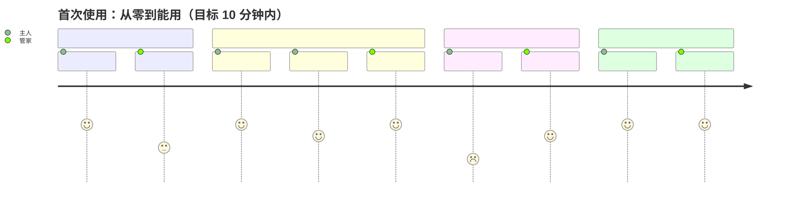

# AI Butler

[](https://github.com/Leowuqunqun/ai-butler/actions/workflows/ci.yml)

[中文](README.md) | English

**Talk like a human in WeChat. Remote-control your own computer.**

It's not remote desktop (that means doing everything yourself), and it's not command-line
forwarding (that means knowing the commands) — it's **replacing computer operation with AI
semantics**: you say what you want, and it goes and finds it, changes it, gets it done.

```
You (WeChat on your phone): 「把桌面那堆图按日期整理一下」
                             (tidy up that pile of images on my desktop, by date)
The butler (your computer):  「32 张图，按拍摄月份分成了 5 个文件夹。要看看清单吗？」
                             (32 images, sorted into 5 folders by shooting month. Want to see the list?)
```


> **Note:** all diagrams under `docs/diagrams/` are labeled in Chinese — we didn't fake it.
> The diagram sources (`.mmd` / `.svg`) are in the repo, so English versions are welcome.

---

## ⚠️ First, the honest state of things

This repo is growing from "a WeChat bridge that works" into "a complete butler product".
**What actually runs today is the bottom two layers** (connection + conversation); the layers
above are still being designed or built:

| Layer | What | Status |
| --- | --- | --- |
| ① Connection | One-line install (double-click `install.command`) + QR login + onboarding page | ✅ **Works** (no Node to install, no admin password) |
| ② Conversation | Send/receive text, voice transcription, send files, quote prefix | ✅ **Works** |
| ② Conversation | **Receiving images / files** (CDN download + decrypt + saved locally, handed to the agent) | ✅ **Works** |
| ③ Capability | The agent does the work (pluggable backends: DSH / any command line) | ✅ **Works** |
| ③ Capability | Memory, proactive reminders | Memory ✅ usable (`记住` / `记忆` / `忘掉第 N 条`); auto-extraction & proactive reminders 📐 not started |
| ④ Devices | Multi-terminal (hub + nodes + alias routing + pairing devices from WeChat) | ✅ **works** (two machines; `@the-one-at-home` in WeChat reaches that one) |
| ⑤ Trust | Approval, audit | 📐 Designed, not started |

**Want to see what it's meant to become** → [`docs/`](docs/)

---

## Install (for people who just want to use it)

**One line** (macOS / Linux — no Node needed; it downloads one and checks the SHA256):

```sh
curl -fsSL https://github.com/Leowuqunqun/ai-butler/releases/latest/download/install.sh | sh
```

Prefer not to touch a terminal? Download the bundle, unzip it, and **double-click `install.command`** → <https://github.com/Leowuqunqun/ai-butler/releases/latest>

When it finishes, your browser opens a page and **only two steps are left**: paste a model key once,
then scan one QR code with your phone.
(On macOS the first double-click gets blocked — right-click it → Open. We didn't buy Apple's
signing certificate.)

The full walkthrough (written for a completely non-technical reader, with a tick-off acceptance
checklist and a "stuck? look here" table; Chinese only, on purpose) →
[**From zero to driving your computer from WeChat: three steps**](docs/GETTING-STARTED.md)
Command-line details live in [`packages/cli`](packages/cli) (860 offline tests across the repo).

---

## The end state

A non-technical user should be able to walk through these five steps alone (target: under 10 minutes):



1. **Install** — double-click the installer. No Node, no terminal
2. **Connect** — the onboarding page shows a QR code; scan it with WeChat. It asks exactly two questions (which computer to manage, what you normally use it for)
3. **Configure** — it walks them through applying for a model key and pasting it. **It never asks for a working directory or a port**
4. **Use** — just talk like a human, inside WeChat
5. **It remembers** — 「以后简历都放 Documents/简历/」 (from now on, put every resume in
   Documents/简历/), and you never say it again

**There is no config file** anywhere in that journey. Configuration happens in WeChat too:

```
「帮我改一下工作目录到 项目/2026」   — change my working directory to 项目/2026
「以后别在半夜给我发消息」           — stop messaging me in the middle of the night
「把操作的确认级别调高一点」         — turn up the confirmation level for operations
```

---

## Repo layout

```
packages/
  seam-channel/        ✅ channel service slot ctx.channel (TypeScript; interfaces only, no implementation)
  seam-agent/          ✅ agent service slot ctx.agent (interfaces only, no implementation)
  seam-link/           ✅ link service slot ctx.link (interfaces only, no implementation)
  seam-approval/       ✅ approval service slot ctx.approval (interfaces only, no implementation)
  seam-memory/         ✅ memory service slot ctx.memory (interfaces only, no implementation)
  core/                ✅ the kernel (the hub role): claim ownership, routing, queue, progress, reply, approval relay, `doctor`
  channel-wechat/      ✅ channel implementation: WeChat (iLink protocol) QR login, send/receive, attachments, pluggable backends
  channel-telegram/    ✅ channel implementation: Telegram (pure `fetch`, zero deps, long-poll; the second channel — this is what proves the abstraction)
  agent-dsh/           ✅ agent implementation: DSH headless agent (with tool-level progress)
  agent-exec/          ✅ agent implementation: any "one question, one answer" command-line program
  approval-im/         ✅ approval implementation: ask the owner in the conversation (default)
  memory-file/         ✅ memory implementation: JSON files (0600 + atomic writes)
  link-lan/            ✅ link implementation: LAN (HTTP + SSE, zero deps; two entry points: hub / node)
  link-tailscale/      ✅ link implementation: across networks (the roster is asked of Tailscale; the wire protocol is link-lan's)
  cli/                 ✅ the entry point `butler`: config + patch overlay → bring up the container → go online / `doctor`
  (the following are not packages yet)
  channel-feishu/      —— candidate: a third channel
  hub/ node/           —— the roles already have owners: hub is `core/`, node is `link-lan/node`
  installer/           —— the installer script already ships at the repo root (install.sh); the package isn't split out yet
docs/                  product and technical architecture, 18 diagrams
scripts/               diagram rendering + docs/package-structure checks + mutation testing
```

---

## Docs

| Doc | What's in it |
| --- | --- |
| [VISION.en.md](docs/VISION.en.md) | Goals, the end state, the conclusions on three forks in the road, the hard parts |
| [ARCH-product.en.md](docs/ARCH-product.en.md) | The five-layer capability model, the user journey, the four core mechanisms, product boundaries |
| [ARCH-technical.en.md](docs/ARCH-technical.en.md) | Topology, packages and seams, contracts, patch layering, sequence, degradation table |
| [GLOSSARY.md](docs/GLOSSARY.md) | **Chinese↔English term table**: the rules translations follow, and a key to the Chinese source comments |
| [docs/diagrams/](docs/diagrams/) | 18 architecture diagrams (sources and color conventions included) — start with the [overall architecture](docs/diagrams/arch-00-overview.svg) |
| [seam-channel/README.md](packages/seam-channel/README.md) | **Read this to wire up a new IM (Telegram/飞书…)**: contract, examples, the foot-guns we hit |
| [seam-agent/README.md](packages/seam-agent/README.md) | **Read this to swap out the agent doing the work**: the `ctx.agent` contract, examples, the four rules for implementers |
| [seam-link/README.md](packages/seam-link/README.md) | **Read this to add a new link (Tailscale/SSH/your own relay)**: the `ctx.link` contract, the security red line, why progress hangs off the request |
| [link-lan/README.md](packages/link-lan/README.md) | How to configure the LAN link, how to run the node side, the wire protocol, the deliberate choices |
| [link-tailscale/README.md](packages/link-tailscale/README.md) | The cross-network link: why it reuses link-lan's protocol, where the roster comes from, what it gives up on security |
| [core/README.md](packages/core/README.md) | **Read this to know "what happens after a message arrives"**: claiming ownership, queue, progress, lifecycle |
| [agent-dsh/README.md](packages/agent-dsh/README.md) | How to use the agent implementation, plus two foot-guns (`--patch` order, `DSH_HOME` must be isolated) |
| [agent-exec/README.md](packages/agent-exec/README.md) | Hook up your own script / another agent CLI; how a second implementation tests the contract |
| [cli/README.md](packages/cli/README.md) | **Read this to actually run it**: what `butler init` generates, config format, patch semantics, `butler run`, `butler doctor` |
| [dsh-plugin/README.md](packages/dsh-plugin/README.md) | **Read this to add a WeChat channel to DSH alone, without the whole stack**: one-command install from the Release into a profile, the config table (`cwd` / `owner` / ports / `autostart`), what it does not do, and how to run the real-DSH acceptance probe yourself |
| [channel-wechat/README.md](packages/channel-wechat/README.md) | How to use the channel package, configuration, the foot-guns we hit |
| [channel-telegram/README.md](packages/channel-telegram/README.md) | The second channel: how it plugs in, three "rather this than that" calls, **and the one seam leak it exposed** |
| [channel-wechat/docs/protocol.md](packages/channel-wechat/docs/protocol.md) | iLink protocol notes (including measured conclusions) |

---

## Development

```bash
pnpm install            # install deps (Node ≥ 20, pnpm 10)
pnpm build              # build the TypeScript packages → lib/
pnpm typecheck          # type-check only, no output
pnpm test               # every package, fully offline: no network, no WeChat account, no messages actually sent
pnpm check:docs         # docs health check: broken links / anchors / references to gitignored files
pnpm check:packages     # packaging health check: every entry point and build artifact ships
pnpm diagrams           # re-render docs/diagrams/*.svg
```

**The tests are deliberately built to run offline**: the WeChat media part forges its own CDN
ciphertext and runs its own AES decryption to verify things, so it needs no real account and
sends messages to nobody. CI runs the full suite on Node 20 / 22 / 24.

> One `check:docs` rule specifically hunts for 「**references to gitignored files**」 —
> everything looks fine locally, then you push to GitHub and the image is broken.
> Skip that check and you will miss this class of bug, every time.
>
> `check:packages` was **forced into existence by a real incident**: listing file names one by one
> in `files`, missing one build artifact, and the symptom is "it installs, but it will not start"
> (`Cannot find module '…/lib/sessions.js'`) — the repo looks perfectly fine, because the source is
> right there. The rule now is **ship whole directories**, and this script enforces it.

---

## Roadmap

| | What | Acceptance | Status |
| --- | --- | --- | --- |
| **M0** | Channel layer working end to end: QR, send/receive, attachments, quotes, pluggable backends | 19 offline tests | ✅ Done |
| **M1** | Channel layer plugins + receiving images/files + `doctor` self-check + CI + Chinese/English docs | **ship it as open source when this is done** | ✅ Done |
| **M2** | Multi-terminal (hub + nodes + alias routing) + in-WeChat configuration | Two machines; saying "that file on the home computer" in WeChat gets it | ✅ complete |
| **M3** | Non-technical installer (double-click install, onboarding page QR scan, never asks for a key) + a second IM channel | A non-technical user walks the whole thing alone | 🚧 in progress |

> All three M1 items are in place, but **CI has never actually run on GitHub** — the repo
> hasn't been pushed yet. It counts as "shippable as open source" only after the first green run.


M1 breakdown:

| Item | Status |
| --- | --- |
| monorepo rework (pnpm workspace + TS baseline) | ✅ |
| **Receiving images / files** (CDN download + two `aes_key` encodings + decrypt + saved locally) | ✅ 24 tests |
| **The `ctx.channel` seam package** (cordis 4 + TypeScript, interface/implementation split) | ✅ 10 tests |
| **Specifiable data directory** (`--home` / `WAB_HOME`; fixed the foot-gun where a global install wrote into `node_modules`) | ✅ 21 tests |
| CI (Node 20/22/24 matrix + build + typecheck + docs health check + tests) | ✅ |
| **Channel package wired to cordis** (`wechat-agent-bridge/plugin` implements `ctx.channel`, and the CLI usage doesn't regress) | ✅ 27 tests |
| Shutdown without waiting it out (the long-poll can be cut off immediately; `Ctrl-C` used to take up to 40 seconds) | ✅ 5 tests |
| **The `ctx.agent` seam package** (the contract grew out of a working implementation, rather than being drawn first and then forced onto implementations) | ✅ 11 tests |
| **The `ctx.core` kernel** (identity / routing / queueing / progress / honest replies; two required capability slots, `ctx.link` optional) | ✅ 26 tests |
| **The `agent-dsh` implementation package** (DSH headless; turns tool calls into progress the user can see) | ✅ 32 tests |
| **The `agent-exec` implementation package** (any command line; also the second test of the `ctx.agent` contract) | ✅ 21 tests |
| **The `butler` entry point** (config + patch overlay → bring up the container → go online; failing to install is not fatal) | ✅ 52 tests |
| **`butler doctor` self-check** (which line didn't install, which service slot is missing, each layer's own prerequisites; it **also checks the approval wire across the two processes** — will it ask / is anyone there to answer / can it record) | ✅ 30 tests |
| **Chinese/English docs** (4 core docs + glossary; CI checks bilingual structure parity) | ✅ |

M2 breakdown (all landed):

| Item | Status |
| --- | --- |
| **The `ctx.link` seam package** (the link service slot; the judgement "driving a computer from your phone needs no link at all" is written into the package) | ✅ 15 tests |
| **The `link-lan` implementation package** (LAN: HTTP + SSE, zero dependencies; authentication completes **before the first byte is read**) | ✅ 65 tests |
| **`butler node`** (a command-line entry point for the node side, behind a safety gate: it refuses to start if the config contains a WeChat channel) | ✅ 7 tests |
| **Remote files produced on a node** (the node mints a **pickup token** for each file the agent hands out; the hub pulls it back in chunks and sends it to WeChat — a path is **never** passed across) | ✅ 11 tests |
| **Device alias routing** (saying `@the-one-at-home tidy the desktop` in WeChat reaches that machine; **without `@` it always runs locally — no implicit guessing**) | ✅ 34 tests |
| **In-WeChat configuration** (pairing: the other computer prints "pair <address> <code>" on its screen; you send that line in WeChat and it is adopted. The key is **generated by the node itself** and travels only over the LAN; the roster is persisted, so a hub restart still remembers) | ✅ 33 tests (13 pairing + 19 WeChat commands + 1 end-to-end) |
| **The `link-tailscale` implementation package** (the cross-network fallback: the roster is asked of Tailscale — "who is on my network"; the wire protocol is still link-lan's HTTP + SSE) | ✅ 22 tests |

M3 details (in progress):

| Item | Status |
| --- | --- |
| **`butler init`** (first run: the config and the patch are **written by the program**, the user types nothing; only missing files are written, existing ones are never touched; **upgrading from an older version tops up the ability rows it is missing** (memory/approval) so nobody has to open that JSON; `butler run` **says so out loud** when it sees an old config (it writes nothing itself); `run`/`node` hand you one command you can copy) | ✅ 19 tests |
| **a pasted model key is checked before it is saved** (one cheap "list models" call: a 401/402 means it is **refused outright** with the exact next step; a network failure still saves it but says "could not confirm" — a wrong key does not error, it silently looks like \"the butler ignores me\" hours later); checking is **standing guard, not making the decision** — anyone who is sure gets an "I know, save it anyway" button) | ✅ 10 tests |
| **the butler speaks first** (after a successful scan nothing happens in WeChat — and silence reads as "it didn't install". So once the owner is bound the butler says one thing: it's up, three copy-paste examples in plain language, "I always ask before touching your computer", and what to do when the asking gets old; `你能干什么` replays it, it happens **once ever**, and a failed send is never recorded as sent) | ✅ 6 tests |
| **"don't ask me about this kind again"** (his own words: ask often enough and the owner stops reading — that's **approval fatigue**, worse than no approval at all. So there's an explicit, visible, revocable path: replying "以后这类都行 2" grants the **kind**, the WeChat message spells out the consequence on the spot ("including deleting things in that kind"), an auto-allow is recorded as `by: 'grant'` and **never dressed up as "the owner nodded"**, `授权` lists them and `取消授权 1` takes one back, and an unreadable store means **no grant counts at all**) | ✅ 10 tests |
| **a rope to grab when things go wrong** (`butler report` writes one file: versions/OS, file inventory, which config rows exist, the patch, the self-check, the log tail — **not a single key in it**, with secret-looking fields masked at the source and the whole text swept by a scanner, saying so where it masked, and **read-only**) | ✅ 7 tests |
| **The persona ships with the package** (`agent-dsh` carries a patch template: output goes straight into WeChat so no Markdown, files are sent via a `[[file:…]]` line, never click the UI, and the headless approval policy must be `never`) | ✅ |
| **Packaging health check** (`pnpm check:packages` + CI: the missing-artifact accident cannot happen again) | ✅ |
| **`butler run` logs itself in** (with no stored login it brings up a local QR page, **opens the browser for you**, waits for the scan and persists the credentials — no second command; where there is no browser, `qrPage: false` restores the old behaviour) | ✅ 10 tests |
| **The model key becomes one input box** (`butler run` first brings up a loopback-only onboarding page: where to get the key, paste it, write it into a 0600 credential store; **the user no longer edits that YAML**) | ✅ 18 + 14 tests |
| **The patch template no longer asks the user to edit it** (a default DeepSeek channel + `deepseek-flash`, `apiKeyEnv` pinning the reference; the key is written by the onboarding page) | ✅ anti-drift test |
| **A failed start also explains itself** (a QR-scan timeout is no longer a stack trace; a user's Ctrl-C is not a failure and exits 0) | ✅ 2 tests |
| **A production install really runs** (`pnpm deploy --prod` gives a standalone install: four plugins load, all three service slots are present, only the QR scan is left) | ✅ verified |
| **The `install.sh` bootstrapper** (find/download Node and verify the official SHA256 → install a **private dependency tree** under `~/.butler/prefix` → open the onboarding page; `--dry-run` writes not a single byte; `--uninstall` keeps your config and login) | ✅ 12 clean-room end-to-end checks (13 with `--no-node`) + 17 tests |
| **`butler autostart on\|off\|status`** (macOS launchd / Linux systemd --user; the unit file carries **the PATH you have now** — the one the OS gives at login has no `dsh` in it — plus `--no-open`, or every login pops a browser; Windows honestly says "not done yet") | ✅ 12 + 5 tests |
| ★ The clean-room check **caught a distribution-level bug on its very first run** (each of the 11 packages installed with its own `npm i -g` → npm treats each as an independent global package and nests its deps → `agent-dsh` cannot see the neighbouring `schemastery`, so three of four plugins fail to load; one private dependency tree fixed it) | ✅ fixed |
| Double-click install (`.dmg` / `.exe`) | 📐 (needs an Apple $99/yr + a Windows code-signing cert, or Gatekeeper/SmartScreen will block it; `install.command` currently needs right-click → Open) |
| Onboarding page QR scan (no terminal) | 📐 |
| **A second IM channel (Telegram)** (one more package plus one changed `name` in the config: `butler init --im telegram`; **zero** changes to the core or doctor) | ✅ 48 channel tests + 8 switch-IM tests |
| **Channel credentials go through the onboarding page too** (the Telegram bot token no longer makes the user open `config.json`: `butler run` asks once on the same page and stores it in `state/secrets.json` (0600); a value hand-written in the config **wins**; `doctor` reads the same rules and must not contradict `run`; `butler run --again` means **ask again**, and skipping it keeps the old value) | ✅ 24 tests |
| **A real bug fixed along the way** (`--config` pointing elsewhere now moves the patch and dsh-home too, instead of dropping them back into `~/.butler`) | ✅ 1 test |
| ★ The seam leak it exposed **and we fixed** ("how quoting works" belongs to the channel: `SendOpts.quote` outbound, `InboundMessage.quote` inbound; the core no longer prefixes text or parses quote lines, and Telegram is no longer quoted twice) | ✅ 6 tests (each channel pins one rendering, plus routing not being hijacked by a quote) |

| ★ **Mutation testing exposed a fake green** (flipping `doctor`'s "a missing model key must be ✗" to always-true left the whole cli suite green — only the clean-room e2e caught it, and nobody rebuilds a bundle for one change; three cases now pin all three states, and the same mutation was replayed to prove they bite) | ✅ 3 tests |
| **The test suite itself survives being attacked** (`pnpm mutate`: forty promises deliberately broken — quoting rules, credential precedence, `--again` never losing the old value, `keyState` honouring the environment, the three self-check outcomes, doctor's three key states, the wrapper pinning Node, PATH idempotence, honest first-run reporting, the three memory promises (list numbering / the prefix reaching the agent / directory permissions), the four approval promises (timeout = deny / the audit line records the real outcome / an unrecordable question fails closed / never guess from a stale list number), and the five upgrade-and-diagnosis promises (top-up only what is missing / an unreadable config is left alone / a broken approval wire must be reported red / `run` must speak up when it sees an old config / a wrong key must be refused on the spot / a definite error must never trap the user / a report must never contain a key / a report must survive broken files / a report lands 0600 / an auto-allow must never be dressed up as the owner's nod / an unreadable grant store must say so / one kind is never recorded twice / an out-of-range index never revokes anything / the opening line is never skipped / repeated on every restart / or written in jargon) — **all forty bleed**) | **Honest first run** (`--no-open` never claims the browser was opened; a failed open is reported as such — autostart runs exactly that path, so a false claim leaves the user waiting for a window that never appears) | ✅ 4 tests (including the **gate** path that `butler run` goes through — where new fields used to get silently dropped) |
| ✅ `pnpm mutate` = 17/17 |
| ★ **The WeChat channel is also installable as a DSH plugin** (no repo checkout and no npm release needed: one bundle directory plus `dsh plugin --profile web add file:<dir>/plugin`. It does exactly two things — mount the WeChat channel into DSH, and carry messages into a session and replies back out; the work is still done by DSH itself, so the same session is visible and editable in the DSH UI. One session per contact (`wechat-<16 hex>`), messages from one contact run serially, and **the conversation survives a restart**) | ✅ 37 offline tests + a real-DSH acceptance |
| ★ **The real-DSH acceptance caught two bugs offline tests can never see** (① when `source.messageId` has no value it is `undefined`, and DSH takes a **lossless JSON snapshot** before writing a session event — the key disappears in the round trip and the whole message is rejected: `session event "agent/inbox/spliced" carries non-JSON-serializable data`; ② the probe first tried to `insert` a second pi-ai row and hit `configurable provider "amazon-bedrock" is already declared` — the template already has that row, and DSH's `config` is **whole replacement**, not a deep merge. Both fixed, with regression tests) | ✅ one-command probe: `bash probe/run.sh` (throwaway profile + local fake model, no network, no cost) |

**860 test cases in total, all runnable offline** (sixteen packages: seam-channel 12 /
seam-agent 12 / seam-link 15 / seam-approval 7 / seam-memory 6 / core 161 /
channel-wechat 134 / channel-telegram 51 / agent-dsh 40 / agent-exec 26 / approval-im 18 /
memory-file 9 / link-lan 65 / link-tailscale 34 / dsh-plugin 37 / cli 233).
(The per-item counts in the two tables above are the numbers **as of the day that item landed**, and
they keep growing with the feature set — **treat the total on this line as authoritative**.)

The pieces of evidence that carry the most weight:

- The last 7 tests in `agent-dsh` are **end-to-end**: the real `core` drives the real `DshAgent`
  drives a real child process.
- The last 6 tests in `cli` are a **real composition**: three real plugins (the real WeChat channel
  + the real kernel + the real dsh agent) installed into one container, all three service slots
  present, configuration carried end-to-end.
- **47 of the 65 tests in `link-lan` really do start an HTTP node** (or complete a real round
  trip): real listening socket, real authentication, a real connection through `ctx.link`, a real
  call with progress. Five of them target failures that are hard to explain in one sentence (idle
  timeout, dropping mid-stream, wrong key, protocol version mismatch, unknown method) — those are
  the ones users actually hit.
- The 7 tests in `cli` **really do spawn a `butler node` process**: it reads a real config file,
  really opens a port, a hub connects to it, progress really crosses the process boundary, and
  `Ctrl-C` exits cleanly (exit code 0).
- `cli` also holds **M3's acceptance test**: run `butler init` in a **freshly created empty home**,
  then run `butler doctor` — the four plugins really do load, all three service slots really are
  present, and the only thing it has to say is "WeChat is not logged in yet".
  **The config is written by the program, so the names cannot be wrong.**
- Another `cli` entry is the **M3 installer acceptance**: unpack the artifact that would actually
  ship (`dist/*.tar.gz`) and walk "dry-run → real install → `--help` → `init` → `doctor` →
  `autostart --dry-run` → uninstall keeps data" (11 checks) inside a **temporary home and prefix** —
  the real `~/Library`, real launchd and real WeChat are never touched. **It caught the ★ bug in the
  table above on its very first run**, which is exactly why it exists.
- `channel-wechat/test/login.mjs` really **starts a local HTTP QR page** (127.0.0.1 only) and
  feeds a fake client through the whole login: the code really reaches the page, the browser is
  really pointed at that page's address, the credentials really land on disk, the cursor really
  gets cleared, and the page really gets closed afterwards — without a single network call.
- **M2's acceptance criterion has a test of its own** (`cli/test/m2-e2e.mjs`, and **the same four
  cases run against both links**): the hub is a real core plus a real link plugin, the node is a
  real `butler node` **child process**, with one real
  HTTP + SSE round trip in between — say `@the-one-at-home …` in WeChat and **the agent on that
  machine answers while the local agent never runs once**; say `@the-one-at-home send me that file`
  and **the file written on that machine really lands on the hub, byte for byte**; switch that
  machine off and `@` it again, and you get a plain-language sentence rather than silence.
  **Switch to `link-tailscale` (the roster comes from Tailscale, the addresses become tailnet
  addresses) and not one assertion in those four cases changes** — that is how you tell whether the
  `ctx.link` seam is real or made of paper.
- 2 of the 22 tests in `link-tailscale` run against the **real thing**: they read this machine's
  actual `tailscale status --json`, then put a real node on `0.0.0.0` and connect to it **through
  this machine's tailnet address** (the traffic really goes over tailscale0).
- **The pairing path is pinned end to end** (the case marked ★ in `cli`, and the acceptance test
  for this round): the config contains **no id and no key** (which is what a non-technical user's
  config actually looks like) → the real process starts and prints
  "pair 127.0.0.1:41338 4A7-K2M" on its screen → the hub adopts it from that one line → and it can
  **really do work on that computer**. The same test pins two more things: the hub itself has
  **no key at all** (the key was fetched from that machine during pairing), and the code
  **works only once** (a second attempt is told "already used" rather than handed the key again).

That is the evidence that "**ten packages and three seams (`ctx.channel` / `ctx.agent` /
`ctx.link`) really do fit together**" — no longer just drawings.

---

## Three key design calls

1. **Phone to computer needs no network tunneling.** The phone goes through WeChat, the computer
   long-polls Tencent's servers — iLink itself is that ready-made public relay. That's also why
   "controlling the home computer from outside" costs nothing.
   Only **hub → other nodes** needs tunneling, and that goes over `ctx.link` (LAN / Tailscale).
   **We run no servers of our own.**
2. **The agent runs on whichever machine the work happens on.** The hub only handles identifying
   people, routing, approval, and memory. It **never reads files on a node's behalf** — otherwise
   the hub becomes a bottleneck and a privacy black hole.
3. **The architecture aligns with dsh, but dsh's complexity never leaks to non-technical users.**
   The seam split, patch composition, and dependency injection are all lifted straight from dsh
   (even the kernel uses the same cordis), but the patch files are **an escape hatch for developers
   and advanced users**, not the product interface.

---

## License

MIT © 2026 吴群群 (Wu Qunqun)
