# AI 管家

[](https://github.com/Leowuqunqun/ai-butler/actions/workflows/ci.yml)
[](LICENSE)
[](package.json)

[English](README.en.md) | 中文

**用微信说人话，遥控你自己的电脑。**

不是远程桌面（那得你自己动手），也不是命令行转发（那得你会命令）——
是**用 AI 语义替代操作电脑**：你说要什么，它自己去找、去改、去办。

```
你（手机微信）：「把桌面那堆图按日期整理一下」
管家（你的电脑）：「32 张图，按拍摄月份分成了 5 个文件夹。要看看清单吗？」
```



---

## 这是什么

**一个住在你自己电脑上的管家，你用微信跟它说话。**

它不是一个微信机器人框架，也不是远程桌面：**手机和电脑之间不需要网络穿透** ——
手机走微信、电脑长轮询腾讯的服务器，iLink 本身就是那个现成的公共中继
（只有"中枢 → 其他节点"才走局域网或 Tailscale，而且**我们自己不运营任何服务器**）。

想接一个新的 IM、换一个干活的大脑、加一条链路，都各有一个**只声明契约的 seam 包**：
`ctx.channel` / `ctx.agent` / `ctx.link`。第二个通道（Telegram）和第二个大脑
（任意命令行）就是拿来验这三个 seam 的。
要做成什么样、哪些明确不做 → [VISION.md](docs/VISION.md)。

---

## 快速开始

**一行命令**（macOS / Linux；不用先装 Node —— 它会自己下一个并校验 SHA256）：

```sh
curl -fsSL https://github.com/Leowuqunqun/ai-butler/releases/latest/download/install.sh | sh
```

不想碰终端，就下载整包、解压、**双击 `install.command`** → <https://github.com/Leowuqunqun/ai-butler/releases/latest>

装完浏览器会弹出一个页面，**只剩两步**：贴一次模型 key、拿手机扫一次码。
（macOS 第一次双击会被系统拦一下 —— 在它上面右键 →「打开」；我们没买 Apple 的签名证书。）

详细走一遍（给完全不懂技术的人看，附可打勾的验收清单和「卡住了看这里」对照表）→ [**从零到「用微信遥控这台电脑」：三步**](docs/GETTING-STARTED.md)
命令行细节在 [`packages/cli`](packages/cli)（全仓 914 个离线测试）

**已经在跑 DSH，只想给 DSH 加一条微信通道？** 不用装上面这一整套 —— 打包好的 bundle 就在 Release 里，一条命令装进某个 profile：

```sh
curl -fsSL https://github.com/Leowuqunqun/ai-butler/releases/download/v0.1.0/butler-dsh-plugin-0.1.0.tar.gz | tar xz
dsh plugin --profile web add "file:$(pwd)/butler-dsh-plugin-0.1.0/plugin"
```

配置（`cwd` / `owner` / 扫码端口 / `autostart`）、它不做什么、以及怎么先自己验一遍 → [**dsh-plugin/README.md**](packages/dsh-plugin/README.md)

---

## 现在能用什么

这个仓库正在从「一个能用的微信桥」长成「一个完整的管家产品」。
**今天真正能跑的是最下面两层**（接入 + 对话），上面几层还在设计或施工中：

| 层 | 内容 | 状态 |
| --- | --- | --- |
| ① 接入 | 一行安装（`install.command` 双击）+ 扫码登录 + 引导页 | ✅ **能用**（不装 Node、不要管理员密码） |
| ① 接入 | **第三个 IM：飞书**（站在官方 `@larksuite/channel` 上，只写映射） | 📐 骨架 + CLI 已接（`--im feishu`）；**真机还没验收** |
| ② 对话 | 收发文本、语音转写、**发文件 / 图片 / 视频**、引用前缀 | ✅ **能用** |
| ② 对话 | **收图片 / 收文件**（CDN 下载 + 解密 + 落到本机交给 agent） | ✅ **能用** |
| ③ 能力 | agent 干活（可插拔后端：DSH / 任意命令行） | ✅ **能用** |
| ③ 能力 | 记忆、主动提醒 | 记忆 ✅ 能用（`记住` / 回答里写 `[[记住: …]]` 自动记下）；主动提醒 📐 未开工 |
| ④ 设备 | 多终端（中枢 + 节点 + 别名路由 + 微信里配对收设备） | ✅ **能用**（两台机器，微信里 `@家里那台` 就指过去） |
| ⑤ 信任 | 审批、审计 | 审批 ✅ 能用（在微信里问一句；可给带期限的长期授权）；审计 📐 未开工 |

上面每一层的证据（M1/M2/M3 明细、914 个用例怎么分布、哪些是端到端、
干净环境验收抓到过什么 bug）→ [**EVIDENCE.md**](docs/EVIDENCE.md)

---

## 仓库结构

```
packages/
  seam-channel/        ✅ 通道能力位 ctx.channel（TypeScript；只有接口，无实现）
  seam-agent/          ✅ 大脑能力位 ctx.agent（只有接口，无实现）
  seam-link/           ✅ 链路能力位 ctx.link（只有接口，无实现）
  seam-approval/       ✅ 审批能力位 ctx.approval（只有接口，无实现）
  seam-memory/         ✅ 记忆能力位 ctx.memory（只有接口，无实现）
  core/                ✅ 内核（hub 角色）：认主、路由、排队、进度播报、回话、审批中转、自检
  channel-wechat/      ✅ 通道实现：微信（iLink 协议）扫码登录、收发、附件、可插拔后端
  channel-telegram/    ✅ 通道实现：Telegram（纯 fetch 零依赖、长轮询；第二个通道，验证抽象）
  agent-dsh/           ✅ 大脑实现：DSH headless agent（带工具级进度）
  agent-exec/          ✅ 大脑实现：任意"一问一答"的命令行程序
  approval-im/         ✅ 审批实现：在对话里问主人（默认）
  memory-file/         ✅ 记忆实现：JSON 文件（0600 + 原子写）
  link-lan/            ✅ 链路实现：局域网（HTTP + SSE，零依赖；认证是红线；配对码收设备）
  link-tailscale/      ✅ 链路实现：跨网（名册问 Tailscale；线上复用 link-lan 那套协议）
  cli/                 ✅ 入口 `butler`：配置 + patch 叠加 → 拉起容器 → 上线 / doctor 自检
  channel-feishu/      📐 第三个通道：飞书（站在官方 @larksuite/channel 上；50 个离线用例，收到图片/文件会落盘；真机未验收）
  （以下还没拆成包）
  hub/ node/           —— 角色已有归属：hub 由 core/ 承担，node 由 link-lan/node 承担
  installer/           —— 引导器脚本已在仓库根目录（install.sh），包还没拆
docs/                  产品与技术架构、18 张图
scripts/               图渲染 + 文档/包结构自检 + 变异测试
```

---

## 文档

| 文档 | 内容 |
| --- | --- |
| [VISION.md](docs/VISION.md) | 目标、最终形态、三个岔路的结论、硬骨头 |
| [ARCH-product.md](docs/ARCH-product.md) | 五层能力模型、用户旅程、四个核心机制、产品边界 |
| [ARCH-technical.md](docs/ARCH-technical.md) | 拓扑、包与 seam、契约、patch 分层、时序、降级表 |
| [GLOSSARY.md](docs/GLOSSARY.md) | **中英术语对照表**：翻译的规矩，也是读源码注释的对照 |
| [docs/diagrams/](docs/diagrams/) | 18 张架构图（含源文件与配色约定）—— 先看 [整体架构](docs/diagrams/arch-00-overview.svg) |
| [seam-channel/README.md](packages/seam-channel/README.md) | **想接一个新 IM（Telegram/飞书…）看这个**：契约、示例、踩过的坑 |
| [CHANNEL-FEISHU.md](docs/CHANNEL-FEISHU.md) | **想知道飞书能不能接、要付什么代价看这个**：接入形态与权限点、长连接的硬约束、逐条映射到 `ctx.channel`、工作量估算、开工前要定的五件事（**调研，未开工**） |
| [seam-agent/README.md](packages/seam-agent/README.md) | **想换掉干活的大脑看这个**：`ctx.agent` 契约、示例、实现者四条守则 |
| [seam-link/README.md](packages/seam-link/README.md) | **想接一条新链路（Tailscale/SSH/自建中继）看这个**：`ctx.link` 契约、安全红线、为什么进度挂在请求上 |
| [cli/README.md](packages/cli/README.md) | **想知道怎么真的跑起来看这个**：`butler init` 生成什么、配置格式、patch 语义、`butler run`、`butler doctor` |
| [dsh-plugin/README.md](packages/dsh-plugin/README.md) | **只想给 DSH 加个微信通道、不装整套看这个**：Release 一条命令装进 profile、配置表（`cwd` / `owner` / 端口 / `autostart`）、它不做什么、**真机验收自己怎么跑**（`probe/run.sh`） |
| [EVIDENCE.md](docs/EVIDENCE.md) | **想知道凭什么信它看这个**：每一层的验收明细、端到端用例、干净环境真装一遍、变异测试 |

其余各包（`core` / `link-lan` / `link-tailscale` / `agent-dsh` / `agent-exec` / `channel-wechat` / `channel-telegram` / `approval-im` / `memory-file` / `seam-approval` / `seam-memory`）各自目录下都有 `README.md`。

---

## 开发

```bash
pnpm install            # 装依赖（Node ≥ 20、pnpm 10）
pnpm build              # 构建 TypeScript 包 → lib/
pnpm typecheck          # 只做类型检查，不产出
pnpm test               # 全部包，全部离线：不连网、不需要微信账号、不会真的发消息
pnpm check:docs         # 文档体检：断链 / 锚点 / 引用了被 gitignore 的文件
pnpm check:packages     # 打包体检：装出去的包里，入口和编译产物一个都不少
pnpm mutate             # 变异测试：验的不是代码，是**测试本身**（十几分钟，手动跑）
pnpm diagrams           # 重新渲染 docs/diagrams/*.svg
```

**测试是刻意做成离线可跑的**：微信媒体那部分自己伪造 CDN 密文、自己跑 AES 解密来验证，
所以不需要真账号、也不会给谁发消息。CI 在 Node 20 / 22 / 24 三个版本上跑全套。

上面这些检查**为什么存在**（每一个都是被真事故逼出来的）→ [EVIDENCE.md](docs/EVIDENCE.md)

---

## 路线图

| | 内容 | 验收 | 状态 |
| --- | --- | --- | --- |
| **M0** | 通道层跑通：扫码、收发、附件、引用、可插拔后端 | 19 个离线测试 | ✅ 已完成 |
| **M1** | 通道层插件化 + 收图片/文件 + `doctor` 自检 + CI + 中英文档 | **做完就能开源出去** | ✅ 已完成 |
| **M2** | 多终端（中枢 + 节点 + 别名路由）+ 微信内配置 | 两台机器，微信里说"家用电脑上那个文件"能拿到 | ✅ 已完成 |
| **M3** | 小白安装器（双击装、引导页扫码、不问 key）+ 第二个 IM 通道 | 一个不懂技术的人独立走完 | 🚧 进行中 |

里程碑的明细、以及每一条是怎么验的 → [EVIDENCE.md](docs/EVIDENCE.md)

---

## 设计上的三个关键判断

1. **手机到电脑不需要网络穿透。** 手机走微信、电脑长轮询腾讯服务器——
   iLink 本身就是那个现成的公共中继。这也是"在外面遥控家里电脑"零成本的原因。
   只有 **中枢 → 其他节点** 才需要穿透，那走 `ctx.link`（局域网 / Tailscale），
   **我们自己不运营任何服务器**。
2. **活在哪台机器干，就在哪台机器跑 agent。** 中枢只负责认人、路由、审批、记忆，
   **不替节点读文件**——否则中枢会变成瓶颈和隐私黑洞。
3. **架构对齐 dsh，但不把 dsh 的复杂度暴露给小白。**
   seam 拆分、patch 组合、依赖注入全部照搬 dsh（连内核都用同一个 cordis），
   但 patch 文件是**给开发者和高级用户的逃生舱**，不是产品界面。

---

## 许可证

MIT © 2026 吴群群
