# Product Architecture

[中文](ARCH-product.md) | English

> For the technical implementation see [`ARCH-technical.en.md`](ARCH-technical.en.md)｜for the shape and the goals see [`VISION.en.md`](VISION.en.md)
> The diagram sources are in [`diagrams/`](diagrams/). The `.mmd` files are editable, the `.svg` files are rendered output.

**Note on the diagrams: their labels are still in Chinese.** The English docs link to the same
diagram files. The sources are in the repo — English versions would be welcome.

---

## At a glance

Start with the whole picture: **owner → channel servers (WeChat / Feishu / Telegram) → your computer (one cordis container)**, and where each of the five product layers lands.


Each section below opens up one box; the package-to-part mapping is in [`ARCH-technical.en.md`](ARCH-technical.en.md).

---

## Positioning

**A butler that lives on your computer and talks to you over WeChat.**

You say what you want, it drives the computer for you — you don't have to tell it where to click, and you don't have to know the command line.

**It is not**: remote desktop (then you'd be the one doing the work), command-line forwarding (then you'd have to know commands), a multi-user bot service (that's a different product), or SaaS (then your data has to leave the machine).

---

## 1. The product at a glance



Three hard constraints fall straight out of that picture:

1. **No network traversal is needed between phone and computer.** The phone talks to WeChat; the computer long-polls Tencent —
   **iLink itself is the ready-made public relay.** That is also why "remote-control the home computer from outside" costs nothing.
2. **The butler has to live on a machine of your own**, because it has to touch your files.
3. **The model is bring-your-own**, and data only passes through the owner's own model account.

---

## 2. Vocabulary (agree on the language first — everything below uses it)

| Concept | English | Definition |
| --- | --- | --- |
| **主人** | Owner | The only user. **The IM account is the identity** — there is no sign-up, no login |
| **管家** | Butler | The product's personified name. In essence: agent + memory + permissions |
| **中枢** | Hub | One always-on device of the owner's. **The only holder of the IM session**, responsible for identification, routing, approval, memory |
| **节点** | Node | A computer being remote-controlled. **The work happens here** (files and commands are all local to it) |
| **通道** | Channel | The IM that is connected — WeChat / Feishu / Telegram, **one at a time** (several at once isn't supported yet) |
| **链路** | Link | How the Hub ↔ Node traffic travels (LAN / Tailscale / SSH…) |
| **能力** | Skill | One thing the butler can do (find a file, tidy up, send a notification, schedule…) |
| **回合** | Turn | The owner says one thing → the butler finishes it → the butler says one thing back |

> **Why it must be the "only holder of the session"**: an IM account's bot can only have one receiver.
> Two processes receiving at the same time steal messages from each other and their cursors fight each other (measured during M0).

---

## 3. The five-layer capability model


The product as the user perceives it is these five layers, outside in. **Any one layer breaks and the whole experience collapses**:

| Layer | Content | Consequence of failure |
| --- | --- | --- |
| ① Access | installer · onboarding page · QR scan | The non-technical user's first wall; stuck here, the product doesn't exist |
| ② Conversation | text · voice · images · files · quotes | **The one place that cannot give**, stuck here and everything after it is wasted |
| ③ Skills | finding things · tidying up · executing · reminding · summarizing | Decides "is it useful" |
| ④ Devices | routing · aliases · online status | Where the differentiation lives |
| ⑤ Trust | approval · memory · audit · privacy | Decides "dare I use it long-term" |

**The principle for setting priority**: ③ decides "is it useful", ⑤ decides "dare I use it", ② is the floor.

---

## 4. The user journey


| Step | What the user does | What the product does | What must not appear |
| --- | --- | --- | --- |
| 1 | Double-click the installer | Install dependencies, start services, open the onboarding page | Terminal, npm, git |
| 2 | Paste a model key | A local page: where to get it, one box, stored in a 0600 credential file | Hand-writing YAML, API docs |
| 3 | Scan a QR code (WeChat) or paste a credential string (Feishu / Telegram) | WeChat: a scan page that rotates the code automatically (a code lives 90 seconds); Feishu/Telegram: a local page that takes the app_id/secret or the token | Ports, callback URLs |
| 4 | Reply with a "hi" | Claim ownership, create the session, reply with a self-introduction | A config file |
| 5 | Say the first real thing | Do the work | Working directory, permission settings |

> Step 2 used to read "(Optional) enter a model key: guide to apply → copy → paste",
> which landed on the user as a YAML file to edit (provider, baseURL, models,
> contextWindow…). **A non-technical user cannot do that**, so the product now ships a
> default model channel and the user supplies only the key itself — one input box,
> everything else is written by the program.

> **Step 2 happens more than once**: with Telegram the butler asks for the bot token
> **first** (the same page, the same paste-one-thing motion) and then for the model key —
> neither is written into `config.json`; both live in files only you can read (0600).
>
> **What step 1 looks like today**: `install.sh` already does it in one line (check/download
> Node with a checksum → install under `~/.butler/prefix` → open the onboarding page), and macOS
> also gets an `install.command` you can double-click (right-click → Open the first time: we have
> not bought an Apple signing certificate). A real `.dmg` / `.exe` waits on code signing — that
> step costs money, not engineering.

**Acceptance standard**: a non-technical user can get all the way through **without asking anyone**.

### Day to day

```
"Send me that PPT from yesterday"      → finds the file, sends it over
"Clear out my Downloads folder"        → lists what it found first, acts after confirmation
"Archive these images by date"         → receive images + operate + report back
"Remind me at 9 tomorrow to file my weekly report" → scheduled task
```

---

## 5. The four core mechanisms



### 1. Approval: conservative by default, looser the more you use it

- Destructive / outward-facing operations **always ask by default** (delete, overwrite, message someone else, change system settings)
- The owner can authorize "don't ask about this kind any more" → written into memory
- **Timeout = refusal** (if it isn't asked, it doesn't happen — better to do nothing than do the wrong thing)
- **Never silently execute an irreversible operation**

> This is the answer to "dare I hand over my computer". **A config file and an allowlist can never be a
> non-technical user's line of defense**, so approval has to be **productized, and inside the conversation**.

The same self-checks are reachable **from inside WeChat**: reply "自检" and the butler asks every
capability slot in turn (the very same `check()` calls) and answers in plain language. The reason is
practical — when something breaks, a non-technical owner only has WeChat, not a terminal.

One rule on this layer never changes: **no false green**. If a slot's `check()` throws, returns
something that is not a checklist, or does not provide one at all, the report has to say so. The worst
possible failure is calling "we could not check" a clean bill of health — because that report is exactly
what the owner uses to decide whether to ask for help.

**The second line — "this class never has to ask again" — is built**: reply "以后这类都行 2" and the
class is recorded in `state/grants.json` (0600). "授权" lists them, "取消授权 1" revokes one, and when
a grant lets something through the audit says `by: 'grant'` — it **never** masquerades as the owner
having nodded just now.

**Time is the only dimension worth narrowing**: reply "以后这类都行 2，一小时" (30 分钟 / 两小时 /
一天 / 3 天 also work, up to 7 days) and the grant **lapses back to asking every time** on its own.
Why not narrow it to "only this command": scoping a shell command by prefix is a trap — a grant for
`ls` does not stop `ls; rm -rf ~`, so it hands over a **false sense of safety**, which is worse than
a coarse grant.

### 2. Memory: understands you better the more you use it

| Type | Example | How it gets written |
| --- | --- | --- |
| **Preference** | "résumés all go in Documents/简历/" | The owner says so; or **the butler writes `[[记住: …]]` in its own answer** and the core captures it, telling the owner right away |
| **Fact** | "my working directory is ~/work" | Same — **better to miss one than to record a wrong one**: only a whole-line marker counts, at most one per answer |
| **Authorization** | "don't ask before tidying the Downloads folder" | **Only after the owner explicitly agrees**; it can carry a deadline ("just for this hour") and lapses on its own |

The owner can ask "what do you remember about me" at any time, and can also "forget this one".

The marker itself **never leaks into WeChat**: every occurrence anywhere is stripped — stripping is deliberately wider than recording.

### 3. Proactivity: from "answering" to "butler"

- **Scheduled**: report the day's schedule at 8:00 every day, remind about the weekly report every Friday
- **Events**: disk full, backup failed, file changed
- **Proactive reporting**: say something when a long task is done, instead of waiting to be asked

> Proactivity is where the "butler feel" comes from, and **also where the annoyance comes from**. Restrained by
> default: proactive messages have a quota, and one "don't message me in the middle of the night" from the owner turns them off.

### 4. Multi-device: no implicit guessing

- Devices have **aliases** ("the one at home", "the work computer") — the owner can name them
- **The default target is the machine the Hub runs on** (the most-used one)
- **Cross-device only when explicitly specified** — no implicit guessing
- Every device shows **online/offline**; when one is offline it just says "that computer is off right now", no forcing it

---

## 6. Interaction


**Core principle: pure conversation, zero menus.** Every skill is reached by talking.

```
┌──────────────────────────────────┐
│ Butler                           │
├──────────────────────────────────┤
│ ↩ Send me yesterday's PPT file   │  ← quotes the original question (no native quoting in the protocol)
│ Found it — sending it over.      │
│ 📎 季度汇报_2026Q3.pptx          │
│                                  │
│ ↩ Send this file to Mr. Zhang    │
│ Send it to "Mr. Zhang", confirm? │  ← outward-facing operations ask by default
│                                  │
│ [image]                          │
│ This is an invoice, 1280. Want me│  ← image intake
│ to log it in the expenses ledger?│
└──────────────────────────────────┘
```

**Input forms**: text, voice (WeChat already transcribes it server-side — free), images, files, quotes.

**Escape hatch** (the fallback when unsure — **we don't teach it, but it's discoverable**):

```
/help       what can you do
/devices    how many do you manage, are they online
/memory     what do you remember about me
/forget x   forget one entry
/stop       stop what you're doing
```

> **Why slash commands and not buttons**: a personal WeChat account can't send buttons.
> Slash commands are the **only workable structured entry point**, but they have to be something where
> "not understanding them doesn't get in the way of using it".

---

## 7. Product boundaries (explicitly not doing)

| Not doing | Why |
| --- | --- |
| **Multi-user / shared by several people** | The positioning is "your own butler". Multi-user needs four things — identity, isolation, quotas, anti-abuse — and it conflicts with "data never leaves the machine" |
| **Hosted SaaS** | Same as above. And "remote-control a computer" requires a machine of your own holding the session |
| **Reverse-engineering / hooking the WeChat client** | It breaks on every version bump, and the ban risk is high |
| **General-purpose GUI automation** (screenshot + simulated clicks) | Slow, brittle, and it hijacks the screen — dozens of steps and it still may not work. **Exception**: single-purpose scripts with hard-coded coordinates |
| **Rolling out on every platform at once** | macOS first (verified in M0); Windows/Linux added as needed |
| **Building our own relay server** | Borrow Tailscale for cross-network; data never leaves the machine |
| **Feature-stacking "me-too" features** (weather, news…) | Those are "skills", not the product. The butler feel comes from "getting things on your computer done for you" |

---

## 8. How we differ from the alternatives

| Alternative | What it is | How we're different |
| --- | --- | --- |
| Remote desktop | You do the work yourself | **You say what you want, it does the work** |
| SSH / command-line forwarding | You know commands | **You speak plain language** |
| ChatGPT-style apps | Can only chat | **Can actually operate your computer** |
| Cron scripts / automation tools | Must be orchestrated in advance | **Handles things you only thought of just now** |
| WeCom bots | Must be installed, must be certified, can't reach your personal WeChat | **Personal WeChat, scan and go** |
