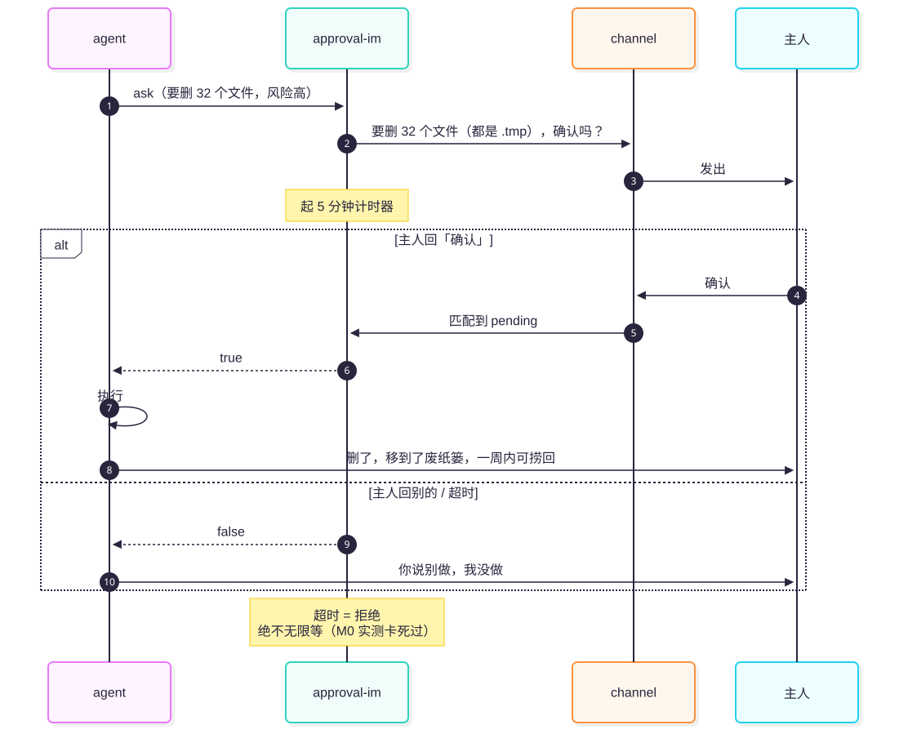
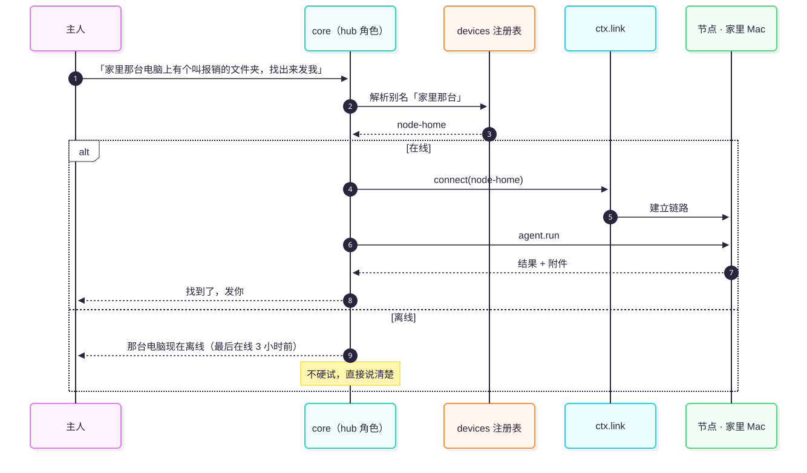
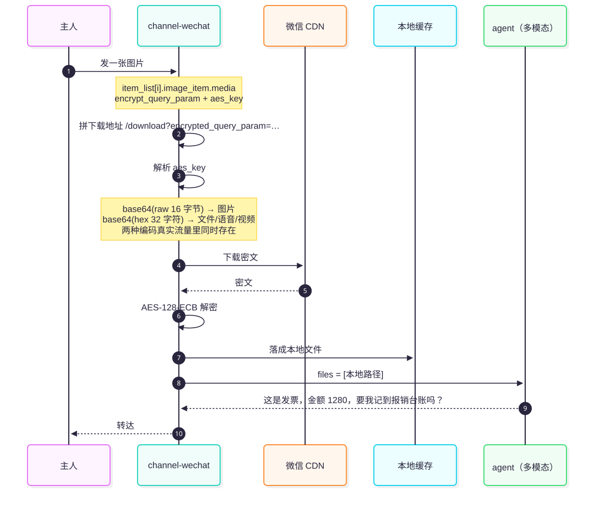

# 技术架构

[English](ARCH-technical.en.md) | 中文

> 产品层面见 [`ARCH-product.md`](ARCH-product.md)｜形态与目标见 [`VISION.md`](VISION.md)
> 图的源文件在 [`diagrams/`](diagrams/)，`.mmd` 可改、`.svg` 是渲染产物。

---

## 一页看全


一张图看完：**主人 → 微信服务器 → 一个 cordis 容器（② 对话 → seam → core → ③ 能力 / ④ 设备 → `state/`）→ 模型服务 / 其他设备**。
容器里那些方框就是本仓的包；下面每一节展开其中一块（源文件 [`arch-00-overview.mmd`](diagrams/arch-00-overview.mmd)）。

---

## 设计原则

1. **照搬 dsh 的骨架，不照搬 dsh 的复杂度。**
   seam 拆分、patch 组合、依赖注入全部对齐 dsh；
   但**普通用户永远不该看到 patch 文件**（那是给开发者和高级用户的）。

2. **只对"有 ≥2 个真实实现"的东西做 seam。**
   微信 + 将来飞书 → `ctx.channel` 值得；
   只有一个设备 → `ctx.devices` 就是个普通服务，**不是 seam**。不做投机抽象。

3. **活在哪台机器干，就在哪台机器跑 agent。**
   中枢只负责认人、路由、审批、记忆——**不替节点读文件**。

4. **每个失败都要说人话地告诉用户。**
   静默失败是产品毒药。宁可回"我搞不定，因为 X"，也不要装死。

5. **唯一持有登录态。** 一个 IM 账号只能有一个收信方。这是硬约束，不是选择。

---

## 一、系统拓扑

### 单机（M1 的形态，先跑通这个）



单机模式下 **hub 内嵌一个 local node**（同进程，不走 Link）——
这是 M1 的默认形态，也是最省事的形态。

### 多机（M2）



> **手机 → 电脑 这一跳根本不需要穿透**：手机走微信、电脑长轮询腾讯，
> **iLink 本身就是那个现成的公共中继。**
> 需要穿透的只有 **中枢 → 其他节点** 这一段，而它走 `ctx.link`。

---

## 二、进程模型

| 进程 | 生命周期 | 职责 | 必须常开吗 |
| --- | --- | --- | --- |
| **hub** | 常驻 | 持有 IM 登录态；认人；会话；路由；审批协调；记忆 | ✅ 是（关了管家就离线） |
| **node** | 常驻 | 接受中枢指令，在本机跑 agent、操作文件 | ✅ 是（否则那台机器不可控） |
| **cli** | 一次性 | 登录、自检、调试、发消息 | ❌ |

---

## 三、包结构与 seam



dsh 的拆法是 **"seam 接口包 + 各自独立的实现包"**（`dsh-bash-local` 的自我描述
就是"bash 执行器 seam 的本地子进程实现"）。照搬：

```
packages/
├── core/                    # ✅ 已建：内核（认主/认路/排队/进度/回话/记忆/审批中转/长期授权（可带期限）/自检（CLI + 微信）/开场白/记忆自动抽取，166 个测试）
│                            #    必需下面两个能力位；ctx.link 可选（只有一台电脑的人不装）
├── seam-channel/            # ✅ 已建：ctx.channel 接口（TypeScript，12 个测试）
├── seam-agent/              # ✅ 已建：ctx.agent 接口（TypeScript，12 个测试）
├── seam-link/               # ✅ 已建：ctx.link 接口（TypeScript，15 个测试）
├── seam-approval/           # ✅ 已落地：ctx.approval 接口（TypeScript，7 个测试）
├── seam-memory/             # ✅ 已落地：ctx.memory 接口（TypeScript，6 个测试）
│
├── channel-wechat/          # ✅ M0 已完成；✅ M1 已接上 cordis（一个包两个入口，见下；134 个测试）
├── channel-telegram/        # ✅ M3：第二个通道（纯 fetch 零依赖、51 个测试）。
│                            #    它的价值不在功能，而在**证明换一个 IM 不用改核心层** ——
│                            #    接进来只动了配置里那一行 name（`butler init --im telegram`）
├── channel-feishu/          # ✅ 第三个通道：飞书（站在官方 @larksuite/channel 上；83 个测试；2026-10-14 真机验收过）
├── agent-dsh/               # ✅ 从 M0 抽出：DSH headless（40 个测试，含 7 个端到端）
├── agent-exec/              # ✅ 从 M0 抽出：任意命令行（26 个测试；也是契约的第二个检验）
├── link-lan/                # ✅ 已建：同局域网直连（HTTP + SSE，零依赖，65 个测试）
│                            #    一个包两个入口：`@butler/link-lan`（中枢）/ `@butler/link-lan/node`（节点）
├── link-tailscale/          # ✅ 已建：跨网（名册问 Tailscale 要 + 配对收下的那部分落盘，线上复用 link-lan 的 HTTP + SSE，34 个测试）
├── approval-im/             # ✅ 已落地：在对话里问主人（默认；18 个测试，一个包两个入口）
├── approval-auto/           # 候选：测试 / 自动化用（还没有真需求，所以还没做）
├── memory-file/             # ✅ 已落地：JSON 文件（9 个测试；0600 + 原子写 + 顺序靠 seq，不靠时钟）
├── dsh-plugin/              # ✅ 已落地：把微信通道打成 **DSH 插件**（37 个测试 + 真机探针）。
│                            #    不 import 任何 DSH 包、只依赖两个 profile 都有的服务，
│                            #    所以 web / headless 都能挂；一个联系人一份会话，跨重启接得上
│
├── hub/                     # 规划中：独立的中枢编排包 —— 这个角色现在由 core/ 承担（单机时同进程）
├── node/                    # 规划中：独立的设备节点包 —— 现在由 link-lan 的 /node 子入口承担
├── cli/                     # ✅ 入口 `butler`：配置 → 装容器 → 上线（含引导页）/ doctor 自检（274 个测试）
│                            #    含 M3 的第一块：`butler init`（配置由程序写，用户一个字都不用填；老配置升级时缺的能力行自己补）
└── installer/               # 半落地：脚本已在仓库根目录（install.sh 生成并双击 install.command，与 CLI 同源），包还没拆出来
```

**命名约定**（学 dsh）：`seam-*` 只声明接口不实现；`<域>-<实现>` 是具体实现；
一个包可以用**子路径导出多个插件入口**（dsh 的 `dsh-plugin-manager/tools` 就是这么做的）。

> **两种装法，同一个通道**：`channel-wechat` 既可以被 `butler` 那套容器装上（上面这些图画的形态），
> 也可以**直接当 DSH 插件装**（`dsh-plugin/`：把通道挂进 DSH、把消息接进会话再把回复送回去）。
> 后者不需要这个仓库的其它部分 —— 认主、排队、会话复用那点业务逻辑在插件包里，
> 而**干活的还是 DSH 自己**（同一个 agent、同一套工具、同一份会话历史）。

> **为什么不一次把 5 个 seam 包都建出来**：接口在没有实现的时候是**猜**出来的。
> M1 只有 `channel`（微信）和 `agent`（dsh/exec）两个真实现，就先只定这两个；
> `link`（✅ 15 个测试）、`memory`（✅ 6 个测试）和 `approval`（✅ 7 个测试）
> 都是等到有第一个实现时才定的 —— 5 个能力位到现在**全部落地**。
> 定 `approval` 的时候还顺手把这条原则又执行了一遍：初稿里的 `ask()` 被删掉了，
> 因为提问的那一头在 dsh 子进程里，管家这一侧**没有任何人要发问**（见下面那节）。
> 这跟本项目"不做投机抽象"是同一条原则 —— `ctx.devices`/`ctx.sessions`/`ctx.store`/`ctx.audit`
> 之所以**故意不做成 seam**，也是这个道理。

---

## 四、seam 契约


### 接口签名（这是契约，先定死）

> **落地形态是 `abstract class`（继承 cordis 的 `Service`），不是 `interface`** ——
> 这样实现者漏掉成员是**编译期**报错，而不是上线才炸。
> `ctx.channel` 已按此落地：[`packages/seam-channel/src/index.ts`](../packages/seam-channel/src/index.ts)；
> 其余域的写法一模一样，只是还没到有实现的时机。

```ts
// ── ctx.channel ─── ✅ 已落地（@butler/seam-channel）────────────
abstract class ChannelService extends Service {
  abstract readonly id: string;                       // 'wechat'
  abstract start(): Promise<void>;                    // 开始收信（内部自己轮询/监听）
  abstract stop(): Promise<void>;                     // 必须能在没 start 过时安全调用
  abstract sendText(to: string, text: string, o?: SendOpts): Promise<SendResult>;
  abstract sendFile(to: string, path: string, o?: SendOpts): Promise<SendResult>;
  setTyping(to: string, on: boolean, o?: SendOpts): Promise<void>;  // best-effort，基类默认 no-op
  onMessage(handler: (m: InboundMessage) => void): void;            // 基类实现（同一 handler 去重）
  offMessage(handler: (m: InboundMessage) => void): void;           // 基类实现
  protected emitMessage(m: InboundMessage): void;                   // 给实现调用；消费者抛错被隔离
}
```

> **跟初稿的三处偏离**（都是被实现逼出来的，不是拍脑袋）：
> 1. `setTyping` 多了 `o?: SendOpts` —— 微信要拿 `typing_ticket` 必须带 `contextToken`，
>    初稿的 `(to, on)` 根本调不通。
> 2. 从 `interface` 改成 `abstract class` —— 用 cordis 的 `Service` 才能拿到
>    "服务位注册 / 卸载回收 / `static inject` 门控" 这些白送的能力。
> 3. `SendOpts` 多了 `quote?: string` —— **第二个实现逼出来的**（见下面那节）：
>    微信只能把"在回哪句"顶成一行文本，Telegram 有原生引用，所以内核只传原文，
>    渲染归通道。

> **`ctx.agent` 跟初稿的三处偏离**（同样是实现逼出来的）：
> 1. **删掉了 `requestApproval`。** 当时是"没有任何实现用它"。M2 落地
>    `ctx.approval` 时这个判断被**第二次确认**：管家这一侧至今没有一个"要发问"的
>    调用方（发问的是 dsh 子进程里的那个 seam），所以连 `ctx.approval.ask()`
>    都没有。契约里留一个没人满足的方法，只会让人以为"已经支持了"。
> 2. **"要发回去的附件"从标记法改成显式字段。** 旧命令行让 agent 在正文里写
>    `[[file:/路径|配文]]` 再由桥解析；配文里出现 `|` 就解析错，类型上也完全看不见。
>    换成显式的 `OutboundFile[]`（**agent 侧的提示词约定不变**，转换由实现包做）。
> 3. **多了 `signal` 和 `code`。** `signal` 是因为 agent 一跑几分钟，
>    停机或改主意不能只能干等超时；`code` 是因为核心层需要**按原因恢复**
>    （会话被占用 → 换新会话重试一次），而不是去匹配错误文案 ——
>    匹配文案那种写法，改一个字就悄悄失效了。

```ts
interface InboundMessage {
  channel: string;
  fromId: string;            // 通道内的用户标识
  text?: string;             // 文本，或语音转写
  files?: LocalFile[];       // 已下载到本地（图片/文件）—— 通道负责，核心层只读路径
  contextToken?: string;     // 回复时带上（微信需要）
  raw?: unknown;             // 通道私有数据，别在核心层读
}

interface LocalFile {        // 附件永远是"本机可读文件"，不是 URL、不是 Buffer
  path: string;              // 本机绝对路径
  name: string;              // 已做安全处理，可直接展示
  mime: string;
  size: number;
  kind: 'image' | 'video' | 'file' | 'voice' | 'unknown';
}
```

```ts
// ── ctx.agent ─── ✅ 已落地（@butler/seam-agent）────────────────
// 契约是**从两个已经跑通的后端里长出来的**，不是先画好再逼实现去满足。
abstract class AgentService extends Service {
  abstract readonly id: string;              // 'dsh'
  readonly label?: string;                   // 人看的名字（不给就用 id）
  readonly cancellable: boolean;             // 这个实现支不支持取消

  abstract run(req: AgentRequest): Promise<AgentResult>;
}

interface AgentRequest {
  text: string;                              // 有附件时**末尾已附上本机路径**
  files?: LocalFile[];                       // 留给一次性多模态后端
  sessionId?: string | null;                 // 续接会话；首次为 null
  cwd: string;
  onProgress?: (line: string) => void;       // 可选；不报也不会被认为卡死
  signal?: AbortSignal;                      // 可选；拉子进程的实现应当支持
}

interface AgentResult {
  sessionId?: string | null;
  text?: string;
  files?: OutboundFile[];                    // 显式字段，不再靠正文里的 [[file:]] 标记
  error?: string | null;                     // 失败必须说
  code?: AgentErrorCode;                     // 'SESSION_LOCKED' → 核心层换新会话重试
}

// ── ctx.link ─── ✅ 已落地（@butler/seam-link；实现 @butler/link-lan、@butler/link-tailscale）──
abstract class LinkService extends Service {
  abstract readonly id: string;              // 'lan' | 'tailscale' | 'ssh'
  abstract discover(): Promise<DeviceInfo[]>;
  abstract connect(deviceId: string): Promise<LinkSession>;    // 连不上要**当场抛**
  pair?(target: PairTarget): Promise<DeviceInfo>;              // 可选：收下一台新设备（名册是外部的链路不需要）
  forget?(deviceId: string): Promise<'forgotten' | 'unknown' | 'static'>;   // 可选：返回结论，不是人话
  check?(): HealthCheck[];                   // 可选，doctor 收集
}

interface DeviceInfo {
  id: string;                                // 稳定标识：不是主机名、不是 IP、不是随机数
  alias: string;                             // 人给的名字，例如「家里那台」
  os: string;
  capabilities: string[];                    // ['agent', 'files']
  lastSeen: number | null;                   // 从没听到过是 null，不是 0
  online: boolean;                           // 「看得见」和「连得上」是两件事 → 两个字段
  link: string;                              // 从哪条链路看见的，例如 'lan'
}

interface LinkSession {
  readonly deviceId: string;
  request(method: string, params: unknown, opts?: LinkRequestOpts): Promise<unknown>;
  onClose(h: (reason?: string) => void): () => void;           // 这条链路断了
  close(): Promise<void>;
}

// 进度**挂在请求上，不挂在会话上**（见下面第二条偏离）
interface LinkRequestOpts {
  onEvent?: (e: LinkEvent) => void;
  signal?: AbortSignal;
}

type LinkEvent =
  | { type: 'progress'; callId: string; line: string }
  | { type: 'done';     callId: string; result: unknown }
  | { type: 'error';    callId: string; message: string; code?: string };

// ── ctx.approval ─── ✅ 已落地（@butler/seam-approval）──────
abstract class ApprovalService extends Service {
  abstract readonly id: string;                                  // 'im' / 'auto' / …
  // **没有 ask()。** 会发问的是 dsh 子进程里的那个 seam；管家这一侧只负责
  // "把待批的念给主人"和"把答复落回去"，没有任何人要发问。
  // 一个没有实现用的接口就是猜 —— 这个项目已经为此删过一次 requestApproval。
  abstract list(): Promise<ApprovalRequest[]>;                   // 旧的在前；已结算的不在里面
  abstract answer(id: string, decision: ApprovalDecision, by?: ApprovalBy): Promise<boolean>;
  //        ↑ false = 没有这件事，或者已经结算过了（同一件事只有一行账）
}

// ── ctx.memory ─── ✅ 已落地（@butler/seam-memory）──────────
abstract class MemoryService extends Service {
  abstract readonly id: string;                                  // 'file' / 'sqlite' / …
  abstract get(key: string): Promise<unknown>;                   // 没记住 → undefined，**不抛**
  abstract set(key: string, value: unknown, meta?: MemoryMeta): Promise<void>;
  abstract list(filter?: MemoryFilter): Promise<MemoryEntry[]>;  // **新的在前**（顺序是契约的一部分）
  abstract forget(key: string): Promise<void>;                   // 幂等
}
```

> **`ctx.link` 跟初稿的两处偏离**（同样是实现逼出来的）：
> 1. **`interface` → `abstract class`。** 理由跟 `ctx.channel` 一样：用 `Service` 才白拿服务位注册、卸载回收、`static inject` 门控。
> 2. **进度从会话级 `onEvent(h)` 改成请求级 `opts.onEvent`。** 初稿把进度挂在整个会话上，
>    一条会话上同时跑两个调用时，每个回调都得自己按 `callId` 过滤 —— 漏一次就是**串话**
>    （A 的进度显示在 B 的结果上）。挂在请求上，串话在类型层面就不可能发生。
>
> 另外补两个初稿里只提到名字、没给形状的类型：`DeviceInfo` 和 `LinkEvent`。
> `DeviceInfo` 里 `online` 和 `lastSeen` **必须分开**，因为它们回答两个不同的问题：
> "看得见吗"（在清单 / 在广播里）和"连得上吗"（真握过手）。
> 用户靠 `lastSeen` 才听得懂"离线"——不能说"连接失败"，要说"最后在线 3 小时前"。

### 第二个实现：换一种找机器的方式，契约不用动（✅ 已落地，见 `packages/link-tailscale`）

`ctx.link` 的第二个实现是**跨网那条**。它证明的不是"又写了一个链路"，
而是**这个契约到底经不经得起换一种实现**：

| | `link-lan` | `link-tailscale` |
| --- | --- | --- |
| 名册哪来的 | 配置里手写的 `peers` + 配对收下的（落盘） | 问 Tailscale：谁在我的网络里 + **配对收下的那部分**（落盘） |
| 地址怎么来 | 手填的局域网 IP | 尾巴地址（`100.x.y.z`），换网换 IP 都不变 |
| 谁算"我的节点" | 配了就算 | **探一下**：答得上来的才算 |
| 线上协议 | HTTP + SSE | **还是 HTTP + SSE** —— 直接复用 `LanSession` / `pingNode` |

三个结论：

1. **分叉的只有"发现"，不该分叉的没分叉。** 第二个实现只多了"问名册"这一步；
   传输、认证、帧解析全部复用 `link-lan`。所以它**只装在中枢那台** ——
   被遥控的那台照旧跑 `butler node`，配置一个字都不用改。
2. **`LinkService` / `LinkSession` / 内核的 `route.ts`，一行都没改。** 换上第二个实现，
   用户能感觉到的行为必须一模一样 —— `cli/test/m2-e2e.mjs` 里那四条 M2 验收标准
   **在两种链路上跑的是同一套用例，断言一个字都没改**（中枢侧只是换了一个插件）。
   这就是判断 seam 真假的唯一标准：换个实现，上面不知道。
3. **契约里那个"`check()` 可以返回 Promise 也可以同步"当初是随手写的，这次用上了。**
   尾巴网络的名册要去问 CLI，自检必须能 `await` —— 不用动契约。

另外这里有个**产品上的分叉**值得记住：`link-lan` 的别名来自中枢的配置，
`link-tailscale` 的别名来自**节点自己报的**。两边的 `DeviceInfo` 形状一致，
所以 `@家里那台` 在两条链路上意思一样。

### 用户怎么把第二台机器交给管家（✅ 已落地：`pair` / `forget`）

前面两节解决的是"怎么找到那台机器"。这一节解决的是**更前面一步**：那台机器怎么**进名册**。

初稿把这一步放在配置里 —— 用户在两台机器的配置文件里各填一个一样的 `secret`。
对懂技术的人这没什么；对**完全不懂技术的人，这一步就是终点**：文件在哪、引号要不要、
抄错一位怎么办，表现出来全都是同一句话："连不上"。

所以改成配对。改的不只是流程，是**谁出这把密钥**：

| | 初稿 | 现在 |
| --- | --- | --- |
| 密钥谁生成 | 用户，两边各抄一份 | **节点自己**（第一次上岗时生成，存 `~/.butler/node.json`，权限 0600） |
| 用户要做什么 | 编辑两个文件、抄一段随机串 | **把屏幕上那一行发到微信里** |
| 密钥怎么到中枢 | 用户手抄 | 配对时**从节点换回来**，只走局域网 |
| 一台泄漏影响几台 | 全部（共用一把） | 只有那一台 |

而"把屏幕上那一行发到微信里"这句话，有两处必须想清楚：

1. **配对码走微信，密钥不走。** 用户是从另一台电脑的屏幕上抄过来的，中间经过腾讯的服务器
   —— 所以那个码**只能用一次、错 5 次作废、30 分钟过期**；它换回来的长期密钥则
   **只在这一条局域网链路上**从节点流向中枢。抄错、被人瞄到，最坏结果只是那一次配对失败。
2. **配对是唯一一个"还没有密钥也能进来"的请求，但红线没破。** 平时是
   `Authorization: Bearer <密钥>`，配对时是 `x-butler-pair: <配对码>` ——
   节点仍然在**读第一个字节之前**就判断完了放不放行。**凭据换了，顺序没换。**

`pair` / `forget` 是 `ctx.link` 上的**可选**方法，这条是被实现逼出来的：**真的有一类
链路不需要它** —— 比如以后可能有的 `ssh` 实现（链路上本来就带登录态，
不用再配一次），内核得能对它说"这条链路不用配对，发「设备」看看"。
**"可选"不是偷懒，是因为真的有一类实现不需要它。**

> 尾巴网络那条链路**原来**也在这类里（名册由 Tailscale 提供、密钥两边本来就一致），
> 后来发现那个前提对用户不成立：**密钥两边一致**意味着用户得在两台机器上把同一串东西
> 抄对，而那正是这条路上最容易放弃的一步；名册只活在内存里，中枢一重启就不认识那台了。
> 所以它现在也实现了 `pair` / `forget` —— 走的还是 `link-lan` 那套一次性配对码握手，
> 换来的身份和密钥当场落盘。**契约没动，只是多了一个实现愿意提供可选能力。**

`forget()` 返回的是 `'forgotten' | 'unknown' | 'static'` 这种**结论**，不是人话：
"这台写在配置文件里，我忘不掉"该怎么说，是内核的事（它知道用户接下来要做什么），
链路只知道"这台不是我管的"。

### 第二个实现：换一个 IM，契约不用动（✅ 已落地，见 `packages/channel-telegram`）

`link` 的第二个实现证明的是"换一种找机器的方式"；通道这边要证明的是更狠的一条：
**换一个 IM，核心层一个字都不用改。**

证据是 `packages/cli/test/switch-im.mjs`，它刻意不看 Telegram 的功能（那是通道自己
的测试），只看结构：

| 断言 | 说明 |
| --- | --- |
| 同一个 `butler init --im telegram` + `butler doctor` | 四个能力位照样齐，`✓ channel @butler/channel-telegram` |
| `packages/core/src` 里**零**通道包名 | 一旦出现，"换通道不用改核心层"就是空话 |
| 换 IM 不搬乱家 | `--config` 指到别处时，补丁 / dsh-home / 通道 state 都跟着走 |

真正变了的东西只有一处：配置里那一行的 `name`。`ctx.channel` 认的是**位置**，不是名字。

三个"契约真的够用"的地方（不是设计出来的，是接的时候发现的）：

- **引用**：`SendOpts.quote` 里放的是"在回哪句"的**原文**，`contextToken` 里带着
  Telegram 要的消息号 —— 于是同一个语义有两种渲染：微信顶一行文本，Telegram 走原生
  引用。**内核只说事实，不决定它长什么样**（这条是第二个实现逼出来的，见下面那节）。
- **附件**：契约说"交出去之前必须是本机文件"。Telegram 取件要两次请求
  （`getFile` 拿路径、再下载），于是通道自己起了一个下载 worker，长轮询只管收信。
- **自检**：`check()` 返回 `{ name, ok, detail, fix }`，doctor 不用认识 Telegram ——
  没填 token 时用户看到的是"找 @BotFather 发 /newbot"，而不是一句校验器的英文。

**★ 找出了一个真漏点，并且修掉了**：出站那行 `↩ …` 是**微信的形态**（微信协议
没有引用字段），可它写在内核里（`quoteLine`），于是 Telegram 用户看到"同一句话
被引用了两次"：通道带了原生引用，内核还顶了一行 `↩`。

修法是给 `SendOpts` 加一个字段，把渲染权还给通道：

```ts
interface SendOpts {
  contextToken?: string
  quote?: string      // 这条消息在回哪句（原文）—— 长什么样是通道的事
}
```

| 谁 | 现在怎么处理 |
| --- | --- |
| 内核 | 只传事实：`{ contextToken, quote: msg.text }`，**一个字都不拼**（`quoteLine` 已从内核删除） |
| `channel-wechat` | 顶一行 `↩ 原话` —— 用户看到的东西**和以前一模一样** |
| `channel-telegram` | 走原生引用回复，文本不动 |
| 过程性消息（进度播报、队列回执） | 不传 `quote` → 不引用（每收到一条"还在处理…"都被引用一次，看着很吵） |
| 终结性回复（答复、**出错**、拒收、命令结果、附件与配文） | 一律传 `quote` —— 规则只有这一句：**终结性引用，过程性不引用** |
| 只发了附件没说话 | 退回一句附件描述（`[文件（报表.xlsx）]`）—— "回的是哪个文件"才是用户关心的 |

两个通道各自的测试钉的是同一个语义的两种渲染：微信断言"文本里出现了 `↩ …`"，
Telegram 断言"`reply_to_message_id` 有值**而且文本里没有 `↩`**"。

**入站那半也修了**：`InboundMessage.quote`。微信把它挂在 text item 的 `ref_msg` 上
（实测结论见 `packages/channel-wechat/docs/protocol.md` 第 7 节），Telegram 挂在
`reply_to_message` 上；两个通道各自压成一行纯文本，内核只认这一个字段。

| 谁 | 现在怎么处理入站引用 |
| --- | --- |
| 通道 | 压成纯文本放进 `quote`；引用的是媒体就调 seam 的 `quotedMedia()`（`[图片]` / `[文件（季度报表.xlsx）]`）—— 写法统一，免得 agent 看到的上下文随用哪个 IM 而变 |
| 内核 · 提示词 | 作为上下文顶在提示词前面（`[引用: …]`）—— 连着发几条时，agent 得知道他在回哪句 |
| 内核 · 路由 | **只看正文**。引用里出现 `@某台设备` 不算在叫设备 |

最后一条不是洁癖，是修掉一个真能踩到的问题：引用并进正文时，用户引用一句带
`@设备` 的**老话**，这条消息就会被送到那台设备上去执行 —— 而他只是在引用自己
以前说过的话。顺带，命令（`配对` / `设备` 这些）同样只看正文。

微信那边还有一处顺带的好处：`ref_msg` 以前**完全没被处理**（用户引用的话是丢的），
现在它真的会到 agent 手上 —— 这是对 **cordis 插件那条路**说的。旧命令行入口
（`bridge.mjs`，`wechat-agent-bridge` 那条命令，仍随包发布）至今不处理入站引用，
它按计划要整个搬进内核后删掉，所以没在它身上补。

最后一句实话：Telegram 这条路**还不是小白路径** —— `botToken` 得自己粘一行配置。
微信那条是扫码（什么都不用填）。要在引导页上加个输入框才能对齐，v1 先这样发。

### 一个包，两个入口（✅ 已落地，见 `packages/channel-wechat`）

微信通道同时是**命令行工具**和**cordis 插件**，靠 `exports` 子路径分开，
而不是拆成两个包：

```jsonc
// packages/channel-wechat/package.json
"bin": { "wechat-agent-bridge": "src/cli.mjs" },
"exports": {
  ".":            { "types": "./src/plugin.d.ts", "default": "./src/plugin.mjs" },
  "./plugin":     { "types": "./src/plugin.d.ts", "default": "./src/plugin.mjs" },
  "./package.json": "./package.json"
}
```

```js
// 用法一：命令行，今天就能跑
//   $ wechat-agent-bridge run

// 用法二：当插件装进内核
import WechatChannel from 'wechat-agent-bridge/plugin';
await ctx.plugin(WechatChannel, { home: '/path/to/data' });
```

**为什么不推倒重写成插件形态。** 命令行那条路是**活的**（真的在服务一个微信号），
而"改完更好"在没有真账号回归的情况下是赌。所以这一轮的做法是**加法**：

| | 收 | 干活 | 发 |
| --- | --- | --- | --- |
| `bridge.mjs`（命令行） | ✅ | ✅ 自己跑后端 | ✅ |
| `plugin.mjs`（cordis） | ✅ | ❌ 交给核心层 | ✅ |

两者**共用底下同一批模块**（`ilink` / `media` / `text` / `store`），
所以协议实现只有一份，不存在两套逻辑各自演化。
`bridge.mjs` 里"跑 agent"那段，等 `ctx.agent` 内核建好之后自然会被它取代。

> **一个刻意的拆分线**：附件的**下载**留在通道里，但**不在收信循环里**。
> 通道内部是"长轮询循环 → 待下载队列 → 下载 worker → `emitMessage`"，
> 所以交出去的 `InboundMessage.files` 永远是已经落盘的本机路径，
> 而慢下载不会让长轮询掉线（掉线就意味着丢消息）。
> 下载 worker 之后的 agent 活干多久，都跟通道无关了。

> **这一轮顺带修掉的一个真问题**：`stop()` 原本会等 in-flight 的长轮询自然超时，
> 也就是 `Ctrl-C` 最坏要卡 **40 秒**。现在协议层接受外部 `AbortSignal`，
> 停机是立刻的。命令行和插件两条路都改了。

---

## 五、落到代码：dsh 的插件模板（照抄，已核对）

cordis 里**一个插件就是一个 Service 子类**，不需要写 `apply()`。
dsh 的 `dsh-bash-local` 就是模板：

**① seam 包 —— 只声明接口，不含实现**

```ts
// packages/seam-channel/src/index.ts   ← 这个文件已经存在，且被 10 个测试跑过
import { Context, Service } from '@deepseek-ai/cordis';

// 这一句给 Context 注册服务位 —— 有它，消费者才有 ctx.channel 的类型
declare module '@deepseek-ai/cordis' {
  interface Context { channel: ChannelService }
}

/** 抽象的通道服务。子类实现抽象方法，把子类当插件加载即注册为 ctx.channel。
 *  一个 context 只能有一个实现；加载第二个会抛错（cordis 的标准行为）。 */
export abstract class ChannelService extends Service {
  constructor(ctx: Context) {
    super(ctx, 'channel');          // ← 服务名在这里定死；子类只写 super(ctx)
  }

  abstract readonly id: string;
  abstract start(): Promise<void>;
  abstract stop(): Promise<void>;
  abstract sendText(to: string, text: string, o?: SendOpts): Promise<SendResult>;
  abstract sendFile(to: string, path: string, o?: SendOpts): Promise<SendResult>;

  // ── 非抽象：基类白送给所有通道 ──
  async setTyping(): Promise<void> {}                       // 默认 no-op
  onMessage(h: (m: InboundMessage) => void): void { … }     // 分发 + 去重
  offMessage(h: (m: InboundMessage) => void): void { … }
  protected emitMessage(m: InboundMessage): void { … }      // 给实现调用
}

export type * from './types.js';
export default ChannelService;
```

**② 实现包 —— 继承 seam 基类，声明依赖与配置**

```ts
// packages/channel-wechat/src/index.ts
import z from '@deepseek-ai/schemastery';
import { Context } from '@deepseek-ai/cordis';
import { ChannelService } from '@butler/seam-channel';

export class WechatChannel extends ChannelService {
  static inject = ['store'];            // 我依赖哪些服务（cordis 会等它们就绪）
  static Config = z.object({            // 我的配置，带校验与默认值
    botType: z.string().default('3'),
    maxReplyChars: z.number().default(1200),
  });

  readonly id = 'wechat';

  constructor(ctx: Context, public config: { maxReplyChars: number }) {
    super(ctx);
    // 收尾一律走 effect（cordis 4 没有 'dispose' 事件）
    ctx.effect(() => () => this.stop(), 'wechat.stop');
  }

  // …实现抽象方法
}

export default WechatChannel;          // 默认导出即插件本体
```

**③ seam 包的 package.json —— 靠 peerDependencies 钉住版本契约**

```json
{ "peerDependencies": { "@deepseek-ai/cordis": "~4.0.4" } }
```

**④ 内核与校验库（都是公网上 dsh 同款，已核对存在）**

| 包 | 版本 | 作用 |
| --- | --- | --- |
| `@deepseek-ai/cordis` | 4.0.4 | 插件内核（dsh 自己用的就是它） |
| `@deepseek-ai/schemastery` | 3.18.4 | 配置 schema，dsh 全用它 |

> 所以"参考 dsh 架构"不是比喻 —— 是**直接用同一套内核**。
>
> ⚠️ 一个细节供你知晓：内核有两个候选 —— `@deepseek-ai/cordis@4.0.4`（dsh 在用，
> 行为 100% 一致）与上游 `cordis@4.0.0-rc.10`（更中立，不绑厂商 scope）。
> **建议先用前者**（对齐优先）；将来若想摆脱厂商 scope 再切上游，两者的
> Service/Context 模型是同一套。

**⑤ 实测核对结果 —— 照抄 dsh 时撞到的差异（都在本机跑过，不是推测）**

写 `packages/seam-channel` 时逐条验证过。**下面这几条跟"照着 dsh 源码抄"的直觉不一样**，
所以单独记下来：

| 事项 | dsh 里的样子 | 实测结论（本项目采用） |
| --- | --- | --- |
| 服务名怎么注册 | seam 构造函数里 `super(ctx, "shell")` | 一样。**服务名由 seam 基类定死**，实现包只写 `super(ctx)` |
| 读配置 | `this.config.timeoutMs.get()` | **不一样**：本项目配置解析出来就是普通值，`this.config.maxReplyChars` 直接读。dsh 那样写是因为它用了 schemastery 的 `volatile()` |
| 卸载收尾 | 满屏 `ctx.effect(() => () => …, '标签')` | **cordis 4 没有 `'dispose'` 事件**（`Events` 里只有 `internal/*`）。收尾只能走 `ctx.effect` |
| `ctx.plugin()` 返回值 | — | 返回 **`Fiber`**：可以 `await`，但它**不是 `Promise` 实例**，`assert.rejects(() => ctx.plugin(…))` 会被 Node 拒掉 |
| 加载失败何时暴露 | — | **异步**。不 `await` 就看不见，**不会**同步抛。测试要写 `await assert.rejects(async () => { await ctx.plugin(Dup) })` |
| `static inject` 没满足时 | — | 插件**根本不会被构造**。所以"重复注册服务位"的报错也要等依赖齐了才出现 |
| 服务位在不在，怎么判断 | — | **不能用 `'name' in ctx`**：cordis 的 Proxy `has` 陷阱在插件卸载之后**仍然返回 `true`**（属性槽位留着不删）。一律用**取值判断**：`ctx.channel !== undefined` |
| 重复实现同一服务位 | — | 抛 `service "channel" has been registered at <XxxChannel>`，**不会静默覆盖** —— 这正是"一个 context 一个通道"的保证 |
| `static Config` 能不能在编译期拦住"漏填必填项" | dsh 用 `z.object({ … })`，靠它是拦不住的（dsh 自己也是在运行期才报） | **拦不住**，机制如下：schemastery 的 Schema **是可调用的**，正好满足 cordis 的 `Plugin.Transform`（`Config: (config: S) => T`），所以 `static Config` 确实是 `ctx.plugin()` 的类型来源；但它的调用签名是 `(value?: S) => T \| null \| undefined`，推断出的 `S` 含 `undefined`，而 `Spread<T> = undefined extends T ? [config?: T] : [config: T]` 一见 `undefined` 就把配置参数判成**可选** ⇒ `ctx.plugin(P, {})` 编译得过。**必填只能靠实现自己的构造函数在加载时拦**（`agent-dsh` 就是这么做的，错误信息点名缺了哪个、以及它是干什么的）。配置**类型写错**（如 `patchFile: 123`）仍然是编译期报错 |

| 插件非得是 `Service` 吗 | dsh 里两种都有 | **不必**。普通 class、普通函数、异步函数都能当插件：`static inject` 门控和 `static Config` 一样生效，`await ctx.plugin()` 也会等异步函数跑完（实测：里面睡 60ms，`await` 就真的等了 63ms）。本项目**仍然优先用 `Service`**（白拿服务位注册），但需要它"准备好了"就得显式给个 `start()` —— **构造函数不能 await**，硬在构造函数里启动会留下一个"已经宣布上线、端口却还没开"的窗口（`butler node` 就是这么处理的：`ctx.node.start()` 由命令行调，跟 `run` 调 `core.start()` 对称） |

> 一句话：**"照抄 dsh"要抄的是结构（seam 包 + 实现包 + `static inject`/`Config` + `export default`），
> 不是逐字的 API 用法。** 上面这些差异都已经固化进测试里了（每个 seam 包、每个实现包都有）。
> ⚠️ 各包**最新的**用例数目不抄在这份文档里 —— 它只维护在
> [项目首页](../README.md) 的「测试」那一段。这里抄一遍就会各自漂移（这行以前就漂过）。

---

## 六、配置与组合（**语义**照搬 dsh，**文件语法**简化）



> ✅ **已落地。** 实现见 `packages/cli/src/config.ts`（叠加语义）与 `boot.ts`（装载）。

```json
{
  "plugins": [
    { "id": "channel-wechat", "name": "wechat-agent-bridge/plugin", "config": { "botType": "3" } },
    { "id": "agent", "name": "@butler/agent-dsh", "config": { "profile": "headless" } },
    { "id": "core", "name": "@butler/core", "config": { "workspace": "/你要它管的目录" } },
    { "id": "link-tailscale", "name": "@butler/link-tailscale", "disabled": true }
  ]
}
```

**保留下来的语义（这几条是真正要紧的，都有测试钉着）**：

- 行由 `id` 寻址，**后写的整行 config 覆盖前面的**（是**整体替换**，不是深合并
  → 所以默认值要在 base 里写全）
- `id` 不存在 → 追加（相当于 dsh 的 `insert`）
- **行的顺序不承载语义**
- base 组合作为**一次叠加**施加在空根上；用户的 patch 再往上叠

**简化掉的是文件语法，两条，都有理由**：

| 简化 | 理由 |
| --- | --- |
| 用 JSON，不用 YAML | 少一个依赖；而且这个文件的第一作者是引导页/GUI，本来就要机器读写 |
| 不要 `- insert:` 外壳 | 现在只有"插入"一种操作，外壳不承载任何信息 |

> ⚠️ **一处刻意的安全性偏离：`disabled` 只收 `true`/`false`，不支持 dsh 的
> `!!js "表达式"`。** 那等于在配置文件里 `eval` 任意代码。对一个"给完全不懂技术的
> 人用"的产品来说这是纯粹的脚下枪 —— 代价（少一个灵活度）远小于收益（少一个
> 任意代码执行的入口）。真需要条件启用时，让**插件自己**根据配置判断，
> 而不是让配置文件拥有执行能力。

### 一条容易误以为"能编译期拦住"的坑

必填配置**拦不住在编译期**。schemastery 的 Schema 是可调用的，正好满足 cordis 的
`Plugin.Transform`（`Config: (config: S) => T`），所以 `static Config` 确实是
`ctx.plugin()` 的类型来源；但它的调用签名是 `(value?: S) => T | null | undefined`，
推断出的类型含 `undefined`，而 `Spread<T> = undefined extends T ? [config?: T] : [config: T]`
一见 `undefined` 就把配置参数判成**可选** ⇒ `ctx.plugin(P, {})` 编译得过。

**所以必填只能靠实现自己的构造函数在加载时拦**（`agent-dsh` / `agent-exec` 都这么做了，
错误信息点名缺了哪个、以及它是干什么的）。配置**类型写错**（如 `patchFile: 123`）
仍然是编译期报错。

### 启动时怎么组合成运行时


**三层配置**：

| 层 | 位置 | 谁写 |
| --- | --- | --- |
| ① 内置组合 | `butler-base/cordis.patch.yml` | 随包发布 |
| ② 用户覆盖 | `~/.butler/cordis.patch.yml` | **引导页 / 微信对话**写它 |
| ③ 运行期状态 | `~/.butler/state/` | 程序自己写（登录态、会话、记忆） |

> ⚠️ **关键原则：架构对齐 dsh，但不把 dsh 的复杂度暴露给小白。**
> 小白只在引导页点几下、在微信里说几句话；
> patch 文件是**给开发者和高级用户的逃生舱**，不是产品界面。

---

## 七、关键流程

### 1. 普通入站回合


要点：**收信循环从不被 agent 阻塞**；干活严格串行 + 排队；长任务定期回报进度。

### 2. 审批



### 3. 审批状态机

长期授权（`core/src/grants.ts`）是这套状态机外面薄薄的一层：**先替主人放行掉
他授权过的那几类，剩下的才念给他听** —— 顺序反过来，念出来的编号里就会混着
已经被放行的，他回「允许 2」会打到另一件事上。

两条不能动的地方：审计里记 `by: 'grant'`（seam 的 `ApprovalBy` 因此多了这一项），
**不许冒名写成 `'owner'`**；授权记录读不动时**一条都不算数**，退回"每次都问"。


### 4. 跨设备（✅ 已实现，见 `packages/core/src/route.ts`）



内核在**唯一那个接缝**（把话交给 agent 的那一步）上认路：**默认本机，显式才跨设备。**

| 用户发的 | 走哪条路 |
| --- | --- |
| `把桌面理一理` | `ctx.agent.run(...)` —— 本机 |
| `@家里那台 把桌面理一理` | `ctx.link.connect('node-home')` → 对面 `agent.run` |
| `家里那台好像坏了` | 本机。**这是话，不是命令** |

> ⚠️ **为什么"话里提到设备名"不能算跨设备。**
> 那不是聪明，是危险：主人说一句"家里那台好像坏了"，隐式匹配会把这句**话**
> 当成**命令**发到那台机器上去执行 —— 在那台机器上真的动起手来。
> 隐式意图识别可以放到以后（让 agent 自己决定调哪台），但**默认路径必须是确定的**。
>
> 代价是用户要学一个符号（`@`）。这个代价我们认，因为它换来的是一条
> **用户能自己推理清楚**的规则。

三条落在实现里、也都钉在测试里的约定：

1. **没 `@` 就一次网络都不发。** `discover()` 只在看到 `@` 时才调 ——
   绝大多数消息走的是零开销那条路。
2. **切名字先用已知别名做最长匹配。** 中文常常不加空格
   （`@家里那台把桌面理一理`），先按别名切、切不出来再退回"第一个词"。
3. **会话按「人 + 哪台机器」分开记**（`node-home#u1` / `u1`）。
   本机那条沿用老键位，升级上来不丢会话。

**没送到 ≠ 办了没办成。** 这两件事的回话方式不一样：前者绝不能被写成
"（agent 出错）"—— agent 连话都没听见，那样说会把用户引到错的地方去查。

#### 那台机器上产出的文件怎么回来：铸取件凭证

M2 的验收原话是"微信里说'家用电脑上那个文件'**能拿到**"。这里有一个绕不开的物理事实：
**那边的路径在这边不存在。** 直接透传路径，微信就会去读一个不存在的文件。

所以链路上**只走凭证，不走路径**：

```
节点 agent 产出  files: [{ path: '/home/leo/报表.xlsx', name: '报表.xlsx' }]
      ↓ 节点自己留一张 token → path 的条子（只在自己内存里、十分钟作废）
过链路            files: [{ token: 'a3f…', name: '报表.xlsx' }]
      ↓ 中枢拿 token 调 file.read，按 512 KiB 分块取
中枢            本机临时文件 → ctx.channel.sendFile
```

> ⚠️ **为什么不是"中枢说个路径，节点读给它"。**
> 那样这个接口就成了"**读取那台电脑上的任意文件**"，而它只需要"把 agent 刚交出来的
> 那几个文件递过去"。差别不是洁癖：局域网里密钥泄漏一次，前者等于把整台机器敞开，
> 后者只是少了一次确认。**能不能做**和**该不该做**在这里正好同向 ——
> 让凭证只能由 agent 的产出铸出来，攻击面就小到不用再讨论了。
>
> 附带一个好处：分块取件顺手让"正在取回 报表.xlsx（63%）"这种播报成为可能，
> 用户不会以为卡死了。

两条不做让步的规矩：**取回来才算数**（取不回来的文件在回复里点名说清楚，
绝不假装发出去了）；**半截文件不发**（传到一半断了就删掉，宁可报错）。

### 5. 收图片 / 文件（✅ 已实现，见 `packages/channel-wechat/src/media.mjs`）



iLink 的入站媒体**不是 URL，是加密的 CDN 凭据**，必须下载 + 解密：

```
item_list[i].image_item / file_item
   media: { encrypt_query_param, aes_key, encrypt_type, full_url? }
   │
   ├─ ① 拼下载地址（有 full_url 就直接用它）
   │     `${CDN}/download?encrypted_query_param=${encrypt_query_param}`
   │
   ├─ ② 取 aes_key —— 图片有**两个来源**，且 image_item.aeskey 优先：
   │     image_item.aeskey（hex 串）  ← 图片专用，漏了就是乱码
   │     media.aes_key               ← 通用兜底
   │
   ├─ ③ 解析 aes_key —— ⚠️ 两种编码在真实流量里同时存在：
   │     base64(raw 16 字节)            ← 图片
   │     base64(hex 字符串 32 字符)      ← 文件 / 语音 / 视频
   │     （判据：base64 解码后长度是 16 就是前者，是 32 且全 hex 就是后者）
   │
   ├─ ④ 下载密文 → AES-128-ECB 解密（没有 key 就是明文，直接下）
   │
   └─ ⑤ 落成 state/inbox/<时间>-<安全文件名> → 把**本机路径**交给 agent
```

> 这个坑与**出站**那个恰好对称：出站写文件时 `aes_key = base64(hex(key))`。
> 不知道这件事的表现是"图片收到了但打不开"。

两个刻意的边界：

1. **下载在干活循环里，不在收信循环里。** 下一个 100MB 文件的途中你还得能收到新消息。
2. **桥只把文件落到本机，不替 agent 理解它。** 交给 agent 的是一个普通路径，
   图片它自己看、xlsx 它自己解析。换模型、换后端都不影响附件能不能用。

---

### 6. 第一次运行：从空目录到能用（✅ M3：`init` + 引导器 + 自启动都已落地）

一台空机器上，四件事按顺序发生，**每一件都由程序做，不由用户做**：

| 步骤 | 谁做 | 产物 | 没有它会怎样 |
| --- | --- | --- | --- |
| `butler init` | 程序写下配置和补丁（**老配置升级时，缺的能力行也会自己补上**；`butler run` 看见老配置会当场说一句 —— 它自己不写文件） | `~/.butler/config.json`、`~/.butler/dsh.patch.yml` | 用户得手拼四个插件名和绝对路径，错一个字符的表现是"装不上" |
| 贴模型 key | **用户**（一个输入框；整条路上要动手的地方只有这一两个） | `<dsh-home>/.credentials.yaml`（0600） | 以前要手写 YAML 里的 provider / baseURL / models —— **小白做不到**；贴进来会**当场验一把**（401/402 拦住不许存，只说清下一步；真要存的人还有一个「我知道」的按钮 —— 把关，不做主） |
| 贴通道 token（**只在用 Telegram 时**） | **用户**（同一个页面的另一种问法：一个输入框） | `<管家目录>/state/secrets.json`（0600） | 以前要自己打开 `config.json`、找到通道那一行、把 `botToken` 填进去 —— **小白做不到** |
| `butler run` ① | 装载四个插件 → 起一个只监听回环的**引导页**（带一次性随机串）、自动开浏览器、等他贴 key、写凭据库 | 模型 key | 以前这里要他去改 patch 里的 provider：那一步是终点 |
| `butler run` ② | 通道自己起扫码页、自动开浏览器、等扫码、落盘 → 上线 | 微信登录态 | 以前这里直接报错，让人去跑另一条命令（名字他猜不出来） |
| 在微信里说第一句话 | 用户 | 认主 | —— |

三条设计约束：

1. **只有 `init` 写文件。** `run` / `node` 缺配置时不写、不问，只给一行能直接抄的命令 ——
   于是它们保持"只读"：可测，也不会在你调试别的事情时偷偷改你的家。
2. **只写缺的。** 第二次 `init` 一个字节都不动（用户可能已经加过设备、改过目录）。
3. **模型 key 不进这两个文件。** 它走 DSH 自己的凭据库，所以这条路**不问 key** ——
   patch 里留的是 `apiKeyEnv` 那个名字，不是 key 本身。

> 「装载」和「上线」是两步：插件装上了不等于上线了。通道的 `start()` 可能正在等人扫码，
> 它抛出来的错误（扫码超时 / 用户取消）必须在 CLI 那一层被接住 —— 前者给一句人话，
> 后者不当成故障（退出码 0）。

### 6.1 安装器：把小白的第一次压到"三步"（✅ 已落地）

`install.sh` 是**引导器**，不是"把 Node 打进一个二进制"—— 管家干活要靠 `dsh`，
而 `dsh` 自己就是个 Node 程序，把运行时打包进去也照样要求机器上有它。所以正确的形态是：
**检查 → 下载 → 装好 → 起引导页**。

| 步 | 做什么 | 为什么这么做 |
| --- | --- | --- |
| ① Node | 先用机器上现成的（≥ 20）；没有就下**固定版本**的官方包，**校验 SHA256** 再解开到 `~/.butler/runtime` | 不用 `latest`：装出来的东西要可复现，校验才有意义。**全程不要 root** |
| ② 装 | 11 个 tarball 装进 `~/.butler/prefix/app` 的**一棵私有依赖树**，再把命令链到 `<prefix>/bin/butler` | 见下面那个 bug |
| ③ PATH | 打印该加哪一行（只有 `--add-path` 才替你写，而且幂等） | 不擅自改用户的 dotfiles |
| ④ 起 | `butler run`（浏览器弹引导页）。`--uninstall` **保留** `~/.butler` 里的配置和登录态 | 卸载 ≠ 删你的东西 |

**★ 干净环境验收第一次跑就抓到的 bug**：一开始按 `npm i -g *.tgz` 装 11 个包 —— npm 会把
每个包当成**独立的全局包**、各自的依赖嵌套在各自目录里，于是 `@butler/agent-dsh` 找不到
隔壁的 `@deepseek-ai/schemastery`，四个插件里三个装不上。改成"一个私有项目里的依赖树"
（形状和发布后 `npm i -g @butler/cli` 完全一样）就全绿了。
**这类问题只有真装一遍才会暴露**，所以 `scripts/verify-clean-install.sh` 是常设验收：
它先打出真正要发出去的那个 `dist/*.tar.gz`，解开，在一个**临时家目录 + 临时前缀**里
走完"dry-run → 真装 → `--help` → `init` → `doctor` → `autostart --dry-run` → 卸载留数据"。
（**升级**那条路是另一个常设验收 `scripts/verify-upgrade.sh`：装真的旧版本、用**老 CLI** 生成配置、
再把"用户自己改过的东西"塞进去，然后用**发布出来的**新 `install.sh` 就地升级 —— "干净机器第一次装"
永远验不到"住着的房子"里那些东西还在不在。）

上面那条链子后来又抓到两条，都长在"只有真发给别人"才会出问题的地方，现在都钉在脚本里：

· 分发包里的 `README.txt` 印着**打包那台机器**的绝对路径（`cd "$(pwd)"` 是**打包时**求值的）——
  收件人照着抄，那个目录根本不存在。现在改成"把文件夹拖进终端"，打包脚本里另加一道门：
  一旦混进打包机的路径，这个包就别发出去。
· 刚装完、什么都还没配的时候，`doctor` 说"先把这份配置文件修好"—— 而**文件根本不在**。
  文件不在和文件坏了是两回事：前者现在给的是那一行能抄的 `butler init`。

**CI 也一样**：推不上 GitHub，就把 CI 的每一步在本地**干净副本**上逐条跑一遍（不带
`node_modules`、用 `pnpm install --frozen-lockfile` 起）。这一步顺手抓到 workflow 里
`pnpm/action-setup` 写了 `version: 10`，而 `package.json` 里有 `packageManager: pnpm@10.32.1`
—— 两个来源，推上去第一次跑就可能红。现在只留 `packageManager` 一个来源（它也确实是
锁文件对应的那个确切版本，而不是任意 10.x）。

**同一个页面引擎问两件事**：模型 key（存 DSH 的凭据库）和通道凭据（存
`state/secrets.json`）。页面文案跟着**具体那件东西**走（key 去哪儿拿、token 去哪儿拿
完全不是一回事），但**安全相关的代码只有一份** —— 一次性随机串、只监听回环、
请求体上限这些再复制一遍，就是迟早出事。
覆盖顺序：配置里手写的 > 引导页存过的 > 都没有就问他一次；`doctor` 按同一套读
（只读，不起页面），所以它不会和 `run` 互相打脸。
`butler run --again` 是"**再问一次**"而不是"清空重来"：他跳过（或直接关掉页面），
原来那把必须照样能用 —— 否则换 key 这个动作本身就能把管家弄哑。
⚠️ 这一关必须在**装进容器之前**跑完：插件的 `config` 是构造时读进去的
（`boot()` 因此多了 `rows` 参数）。

自启动（`butler autostart on|off|status`）有两个坑，都在单元文件里处理了：
文件里带**当前这份 PATH**（登录时系统给的 PATH 里没有 `dsh`，而它是管家思考要用的东西），
命令带 `--no-open`（否则每次登录弹一次浏览器）。Windows 上**如实说"还没做"**。

**✅ PATH 自检收口（已落地）—— 管家自己找得到 `butler` 吗**

`install.sh` 的立场是"**不擅自改你的 dotfiles**"（要加才用 `--add-path`），所以装完之后连用户
自己都得敲全路径。更要紧的是管家**自己 spawn 出来的 shell** 里也没有这个命令 —— 于是
"在微信里跟它说一句、让它自己设开机自启"这条路不保证走得通（它会回你"找不到 butler"）。
给小白那张纸上已经如实写了这条退路，但**退路不该是终点**。现在它成了终点那一头：

| 做了哪半 | 落在哪儿 | 怎么知道的 |
| --- | --- | --- |
| 管家自己的 PATH 里有 `<prefix>/bin` | `install.sh` 生成的**壳脚本**（`exec` 之前设置 —— 只改这一个进程，仍然不动用户的 dotfiles） | 干净环境验收：真装一遍、grep `doctor` 的输出 |
| 判据本身 | 内核自检 `管家自己找得到 butler 吗`（`packages/core/src/butler-path.ts`） | `packages/core/test/core.mjs`（✓ / ✗ 各一条；✗ 那条要说清出路） |
| **一处判据、两处可见** | `doctor` 问 `ctx.core.check()`（`boot()` 之后 SPINE 那一圈）；微信「自检」问的是同一个 `check()` | `packages/cli/test/doctor.mjs`（**真内核** + doctor）与 `packages/core/test/commands.mjs`（微信那份报告） |

这一项过了，"在微信里让它自己做"才从"也许行"变成"行"。

**落地时踩到的三件事（留着，免得下次再试一遍）**：

1. `install.sh:245` 那个 `cat > "${BUTLER_BIN}" <<WRAP` 是**无引号 heredoc**（里面的
   `${NODE_BIN}` / `${CLI_JS}` 要在装的时候展开）⇒ 插进去的 `$` 必须转义：
   `BUTLER_BIN_DIR=\$(cd "\$(dirname "\$0")" && pwd)`。漏一个，`$0` 在装的时候就变成了 `install.sh`。
2. **"`doctor` 不打印内核自检"是误判，别再照着它绕路。** 当初是在干净环境里 grep 不到"内核"
   二字，才以为 doctor 没走内核那条路。实测（`doctor.mjs` 里那两条**真内核**用例）：doctor 走的
   就是 `ctx.core.check()`，只是打印时分组标题叫 `自检`、不写"内核"二字。⇒ **不需要**把
   `check()` 收进 doctor，它本来就在那儿；也**不要**改成"去读微信那条路"。
3. 凡是量"**环境里的 PATH**"的判据，在开发机 / 测试环境里**必然报 ✗** —— 那儿根本没有 `butler`。
   挪到内核自检，红的是 `core` 的用例；挪到 CLI 的 `doctor`，红的是 `cli` 的用例。
   **换地方不解决问题，只是换一批红的用例。** ⇒ 各包 fixture 给 PATH 造一个**真 shim**
   （可执行文件，不是打桩成"跳过检查"）：**改环境、不改判据**；注释里写明
   "**这里造绿不算数，真正把关的是干净环境验收**" —— 那条验收跑在**真装出来的**进程里
   （wrapper 在位），它才是这条判据的唯一裁判。

**收尾条件（这一节开工时就写下的，已满足）**：`pnpm -r test` 全绿 + 一处新变异见血
（`PATH：管家找不找得到 butler 永远说 ✓`）+ 重打包 + 干净环境验收 **19 项** 全过。

**故意没做的**：`.dmg` / `.exe` 要 Apple（$99/年）和 Windows 的代码签名证书，
否则 Gatekeeper / SmartScreen 直接拦 —— 这不是技术问题，是账号和钱的问题。

## 八、数据模型


全部落在 `~/.butler/state/`（**绝不在仓库里**）：

| 文件 | 内容 | 敏感性 |
| --- | --- | --- |
| `owner.json` | 主人身份（通道 + userId + 绑定时间） | 中 |
| `token.json` | IM 登录态 | **⚠️ 等同账号密码** |
| `devices.json` | 设备注册表：id、别名、OS、能力、上次在线、link 类型 | 低 |
| `sessions.json` | `(channel, fromId, deviceId)` → agent sessionId | 低 |
| `memory.json` | 偏好 / 事实 / 授权 | **高（含隐私）** |
| `approvals.jsonl` | 审批记录（谁批的、批了什么、谁批的/到点结的） | 中 |
| `audit.jsonl` | 收发流水 | 中 |
| `pending/` | 未决审批（带超时）。`<id>.json` = 在等；`<id>.answer` = 已有结论的**凭据**（结算时不删，24h 后清） | 中 |

**会话维度是三元组**，不是二元组——因为同一个人在不同设备上的上下文可能不同
（"那个文件"在家用电脑 vs 公司电脑指的可能是不同东西）。

---

## 九、技术选型

| 项 | 选择 | 理由 | 状态 |
| --- | --- | --- | --- |
| 运行时 | **Node ≥ 20，ESM** | M0 已验证；跨平台 | ✅ 已定 |
| 插件内核 | **`@deepseek-ai/cordis` 4.0.4** | 组合/patch/依赖注入全白拿，就是"参考 dsh" | ✅ 已定 |
| 配置 schema | **`@deepseek-ai/schemastery` 3.18.4** | dsh 全用它 | ✅ 已定 |
| 语言 | **TypeScript** | 核心价值是"给别人用的插件生态"，类型就是接口契约 | ✅ 已定 |
| 配置 | cordis patch（YAML） | 对齐 dsh | ✅ |
| IM | iLink（微信） | M0 已验证 | ✅ |
| 跨网 | Tailscale / 局域网 | 不自建服务器 | ✅ 已定 |
| 存储 | JSON 起步（✅ 记忆已经这么落地：`memory-file`，0600 + 原子写）→ SQLite | 先简单；记忆/流水量大了再换 | ✅ |
| 模型 | 用户自备 key | 成本为零、隐私最好 | ✅ 已定 |

**TypeScript 的落地约定**（对齐 dsh 的包形态）：

```
packages/<name>/
  src/            ← 源码（TS）
  lib/            ← 构建产物：lib/index.js + lib/types/**/*.d.ts
  package.json    ← "main": "lib/index.js", "types": "lib/types/index.d.ts"
                    "exports": { ".": { "types": ..., "default": ... } }
                    "publishConfig": { "access": "public" }
  tsconfig.json   ← 继承根 tsconfig.base.json
```

`.d.ts` 就是**接口契约本身**——别人接插件时看的就是它。
所以 `seam-*` 包的类型必须一次写对，改它等于破坏性变更（要按 semver 走）。

---

## 十、部署与运行

| 形态 | 怎么跑 | 面向 |
| --- | --- | --- |
| **开发/调试** | `pnpm build && node packages/cli/lib/cli.js run` | 你我 |
| **常驻** | launchd（macOS）/ systemd（Linux） | 开发者 |
| **小白** | 安装器装成服务 + 引导页（M3） | 目标用户 |

**必须装成系统服务，不要 nohup。** M0 踩过：从 shell（尤其从沙箱里）启的进程
会带来嵌套沙箱问题，而且开机不会自启。装成 launchd/systemd 服务**顺带解决**了这两个问题。

---

## 十一、故障与降级

| 故障 | 表现 | 处理 |
| --- | --- | --- |
| 中枢所在机器睡眠/关机 | 管家完全离线 | 如实说；**不承诺永远在线** |
| 某节点离线 | 那台设备不可控 | 直接说"那台电脑现在离线" + 最后在线时间，不硬试 |
| IM 长轮询断 | 收不到消息 | 退避重试（1s 起翻倍，封顶 60s）；游标持久化，不丢消息 |
| 模型调用失败 | 干活失败 | 如实转述错误；**不静默失败** |
| 模型超时 | 卡住 | 硬超时掐断 + 告诉用户"跑了 Ns 没结果，换个说法或拆小点" |
| agent 死循环 | 一直烧 token | 超时 + 步数预算；人格里明确"两次没进展就停下报告" |
| 审批无人应答 | 卡住 → **已根除** | 两条路都是「拒绝」，都不是「等」：应答者到点按「不许」结算；连应答者都没装上时，dsh 的兜底是 `unavailable` → 调用方 fail-closed。（M0 实测卡死过 3 分钟 —— 那是旧版本的行为；补丁里那句「必须 never，否则无限期等待」已经不成立）。那根线**隔着两个进程**、离线测不到，所以 `butler doctor` 在用户机器上查它：会问吗 / 有人接吗 / 落得下盘吗 |
| 并发两条消息 | 串味 | 收/干分离：收信循环从不被 agent 阻塞；干活严格串行 + 排队提示 |
| 会话被别的进程锁 | 续接失败 | 自动换新会话重试一次（M0 已实现） |

### 用户怎么知道出了哪一种：`butler doctor`

上表全是"程序该怎么办"。但真正决定这个产品能不能用的，是**用户遇到问题时
有没有线索**。这个产品最坏的体验不是报错，是**没反应**。

所以每一层都能被单独问一句"你现在行不行"，答案是给人看的：

```
自检
  ✓  数据目录                /Users/me/.butler
  ✗  微信登录态              还没登录过这台机器
      → 启动时会打印二维码，用微信扫一下就好
  ✓  dsh 可执行文件          /usr/local/bin/dsh
  ✗  dsh patch 文件          /Users/me/.butler/dsh.yml 不存在
      → 这个文件里写着模型通道和人格，缺了它干不了活；把配置里的 patchFile 指对
  ✓  谁能指挥它              已认主（第一个跟它说话的人）。别人发消息它会一声不吭
  ✓  管家自己找得到 butler 吗  找得到：/Users/me/.butler/prefix/bin/butler
```

**约定：seam 上的可选 `check?()`。**

```ts
abstract class ChannelService extends Service {
  /** 可选。返回的每一条都会原样出现在 `butler doctor` 的输出里 */
  check?(): Promise<HealthCheck[]> | HealthCheck[];
}
```

`ctx.agent` 上同名同签名。`HealthCheck = { name, ok, detail?, fix? }`。

**为什么放在 seam 上，而不是让 doctor 从外面查**：只有实现自己知道该验什么 ——
微信通道知道登录态存在哪，dsh 知道它要哪个二进制和哪个 patch 文件，
exec 知道 `argv[0]` 在不在。让 doctor 去猜，就得把每个实现的配置 schema 抄一份，
那是维护灾难，也是层次错误。

**三条约定**（写进两个 seam 的 README 了，四份实现都照做）：

- **不抛错。** 真出意外就返回一条 `ok: false` 说明情况。
- **不做重活。** 只查前置条件，不真跑任务 ——
  用户每遇到一次"没反应"就会跑一次自检。
  **例外只有一次"有时限的探活"**（Telegram 的 `getMe`：这串 token 还认不认），
  而且必须**有上限**、**连不上不算故障**（说"这次没查"，仍然 `ok: true`）——
  否则网一断，用户就会去修一个不存在的问题。
- **`detail` 说状态，`fix` 说动作。** `ok: true` 也要写 `detail`
  （"已登录，3 月 2 日扫的码"比一个光秃秃的勾有用）。

**四条工程约束**（都进了测试）：

| 约束 | 为什么 |
| --- | --- |
| `check?()` 必须是**可选**的 | 加这个约定不能把已有实现变成非法。有测试直接断言不实现时 `ctx.channel.check === undefined` |
| doctor **永远不抛错** | 用户跑到这一步说明已经坏了，诊断工具再炸就什么都没了。配置读不了、JSON 坏了、插件自检自己抛异常，全部收成检查项 |
| doctor **零副作用** | 只装载、不启动。有测试断言 `core.start()` 没被调用过 |
| doctor **替离线测试看那根跨进程的线** | 审批一头在 dsh 子进程里、一头在管家进程里，「真的接上了没有」离线怎么测都测不到。所以由 doctor 在**用户机器上**查四件：补丁里是不是 `policy: ask`、应答者那个**绝对路径**存不存在、管家这侧有没有那行、目录落不落得下盘。四条里任何一条不成立 = 安全但没用（敏感操作一律被拒），所以每条都给得出修法 |
| 每条没过的检查**必须带 `fix`** | 那一句话决定用户能不能自己解决，是这个工具存在的全部理由 |

> **一处新增的运行时发现**：`ctx.channel.check === undefined` 这种判断
> **不能**写成 `'check' in ctx.channel` —— 见第五节那张表里关于
> `name in ctx` 在卸载后仍为 true 的实测结论（那张表的最后几行）。服务位是否存在也一样，
> 一律用**取值判断**。

---

## 十二、与 dsh 的对应：照搬了什么、没照搬什么

| dsh 的做法 | 我们 |
| --- | --- |
| seam 包 + 实现包拆分 | ✅ 照搬 |
| patch 文件组合（id/name/config/disabled，last-write-wins） | ✅ 照搬语义 |
| cordis 内核 + schemastery 配置 | ✅ 直接采用 |
| profile 分层（base + 用户覆盖） | ✅ 照搬 |
| 会话 / 存储 / 权限都是可替换服务 | ✅ 照搬 |
| 一个包多入口（`pkg/tools` 子路径） | ✅ 照搬 |
| **面向开发者的 Web GUI 客户端** | ❌ 不做（微信就是唯一的 UI） |
| **账号体系 / 多租户** | ❌ 不做（单人产品） |
| **把 patch 暴露给普通用户** | ❌ **这是最重要的差别** |
